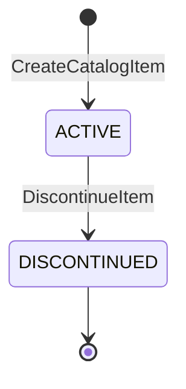
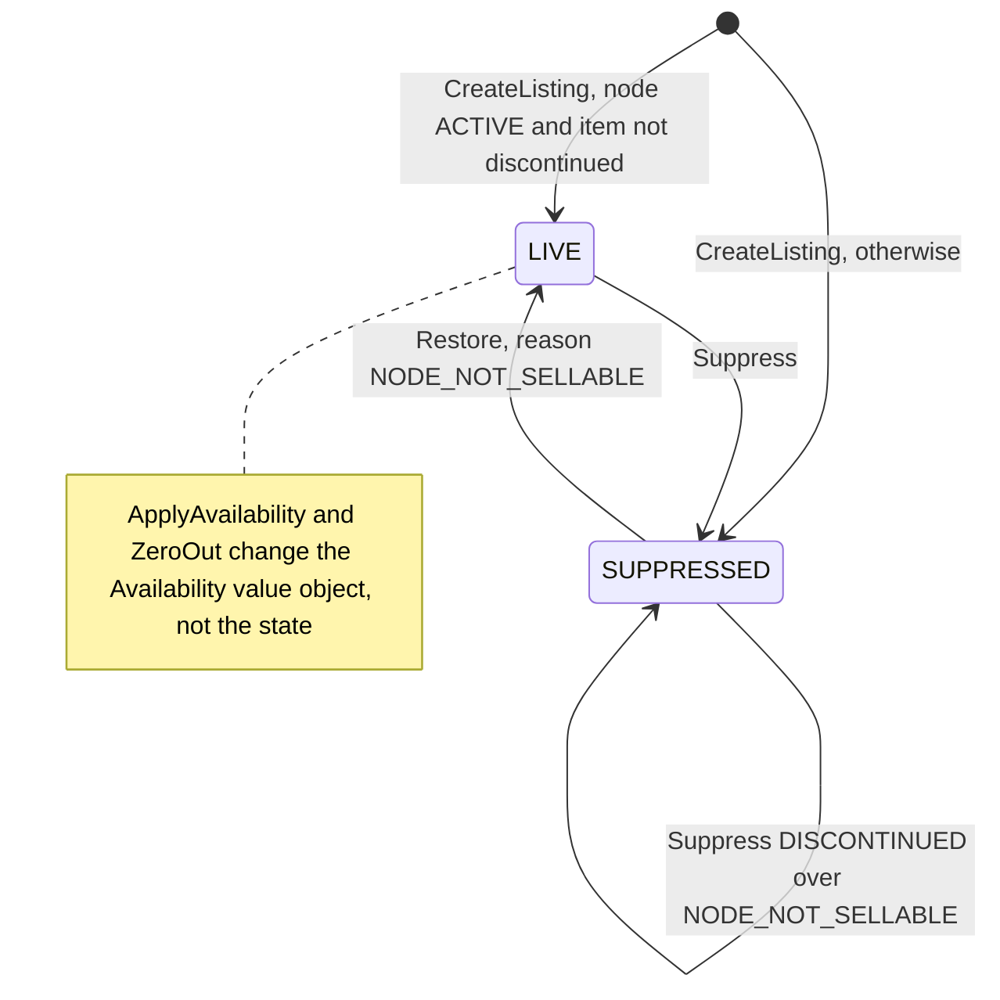
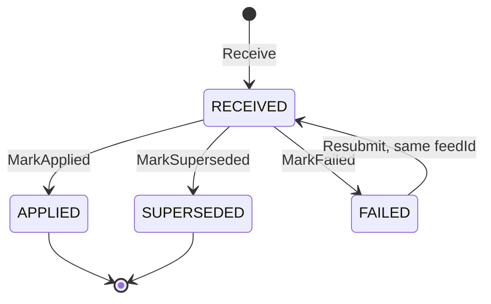

# Aggregate Design Canvas

Following the ddd-crew [Aggregate Design Canvas v1.1](https://github.com/ddd-crew/aggregate-design-canvas). There are three
aggregate roots: **CatalogItem**, **Listing** and **InventoryFeed**; `nodestatus.View` is a read model. The code is
`internal/domain/{catalog,listing,feed,nodestatus}`; the decision record is
[ADR 0002](/docs/adr/0002-aggregates-and-invariants). Every aggregate carries a `version` that counts saves; a save expects
the stored version to be one less, and a mismatch is `ports.ErrConcurrentUpdate` (`concurrent-update`, 409). Throughput and size
are not measured anywhere in the repository, so sections 8 and 9 say what the code does about contention and storage.

## CatalogItem

### 1. Name

`CatalogItem` (Go type `catalog.Item`, `internal/domain/catalog/catalog.go`), identified by `catalogItemId` (minted as
`item-<uuid>`).

### 2. Description

The network's own item master entry: title, dimensions in millimetres, weight in grams, handling flags (`hazmat`,
`fragile`), an optional each-level GTIN and the packaging hierarchy (`catalog.PackLevelDef`, `internal/domain/catalog/packaging.go`).
It is independent of who ships the item. Vendors refer to it through a `listingId`, never by their own SKU.

### 3. State Transitions

Source: `internal/domain/catalog/catalog.go` (`catalog.Create`, `catalog.Item.Discontinue`).

`DISCONTINUED` is final. Discontinuing a `DISCONTINUED` item changes nothing and raises no event. Pack levels have their
own flag, `active`, not a state: a level goes from active to retired and never back.

### 4. Enforced Invariants

| Invariant | Enforced by |
| --- | --- |
| Title 1 to `MaxTitle` characters, trimmed; length, width, height and weight between 1 and `MaxDimension` | `catalog.Create` -> `catalog.ErrInvalidItemDimensions`, `shared.ErrValidation` |
| A GTIN is 8, 12, 13 or 14 digits with a valid mod-10 check digit, stored as 14; indicator digit 9 (variable measure) is refused | `catalog.ParseGTIN` -> `catalog.ErrInvalidGTIN` |
| A GTIN identifies one item or pack level forever | `DeclarePackLevel` -> `catalog.ErrGtinAlreadyAssigned`; across items the `CreateCatalogItem` pre-check and the unique indexes `catalog_items_gtin_key`, `catalog_item_pack_levels_gtin_key` |
| `EACH` has exactly one unit per pack and no child; every higher level has `unitsPerPack` of at least 2, 1 to 1000000 | `catalog.ErrInvalidPackQuantity` |
| A higher level names an **active, lower** child level of the same item, `unitsPerPack` is a multiple of the child's and at least twice it | `catalog.ErrPackLevelOrder`, `catalog.ErrInvalidPackQuantity` |
| Dimensions come all three or none; a gross weight is no lighter than the contents | `catalog.ErrInvalidPackDimensions` |
| The `unitsPerPack` and child of an active level never change for its GTIN; a new quantity is a new GTIN at that level | `catalog.ErrPackQuantityImmutable` |
| A discontinued item takes no packaging change | `shared.ErrIllegalTransition` |

### 5. Corrective Policies

- Discontinuing an item suppresses its listings in the same unit of work: `usecases.DiscontinueItem` calls
  `listing.Listing.Suppress(ReasonDiscontinued)` on every listing of the item that allows it
  ([Use cases](/docs/ddd/use-cases#discontinueitem)).
- A new GTIN at a level that already has an active one retires the old level in the same aggregate version
  (`CatalogItemPackLevelRetired`, then `CatalogItemPackagingDeclared`).
- Neighbours react to the events: `delivery-promise` and `order-sourcing` to `CatalogItemDiscontinued`, `seller-inbound` and
  `vendor-connectivity` to the pack-level events.

### 6. Handled Commands

| Command | Issued by | Inbound adapter |
| --- | --- | --- |
| `CreateCatalogItem` | Network merchandising | REST `POST /catalog-items` |
| `DiscontinueItem` | Network merchandising | REST `POST /catalog-items/{catalogItemId}:discontinue` |
| `DeclarePackLevel` | Network merchandising | REST `PUT /catalog-items/{catalogItemId}/packaging/{level}` |
| `RetirePackLevel` | Network merchandising | REST `POST /catalog-items/{catalogItemId}/packaging/{level}:retire` |

### 7. Created Events

| Event | Raised when | Full CloudEvents type |
| --- | --- | --- |
| `CatalogItemCreated` | `CreateCatalogItem` commits | `com.retailnetwork.commerce.offer-availability.catalogitem.CatalogItemCreated` |
| `CatalogItemDiscontinued` | `DiscontinueItem` moves the item to `DISCONTINUED` | `...catalogitem.CatalogItemDiscontinued` |
| `CatalogItemPackagingDeclared` | a pack level is declared, or re-declared with new dimensions or weight | `...catalogitem.CatalogItemPackagingDeclared` |
| `CatalogItemPackLevelRetired` | a level is retired explicitly or replaced by a new GTIN | `...catalogitem.CatalogItemPackLevelRetired` |

### 8. Throughput

Writes come from merchandising, one item at a time; reads (`GET /catalog`) dominate. Concurrent writers to one item are
resolved by the `version` check; nothing is measured.

### 9. Size

One `catalog_items` row of scalar fields per item plus one `catalog_item_pack_levels` row per level ever declared (retired
ones are kept). Never purged.

## Listing

### 1. Name

`Listing` (`listing.Listing`, `internal/domain/listing/listing.go`), identified by `listingId`. Natural key
(`catalogItemId`, `nodeId`, `ownerRef`).

### 2. Description

One catalogue item offered from one node, optionally for one seller's stock (`ownerRef`, empty = operator-owned), with the
node's claimed available quantity, its basis and the feed it came from. It holds one value object,
`listing.Availability{Qty, Basis, AsOf, FeedID}`. Before the first feed it is `0`, `UNKNOWN`, with no `asOf`.

### 3. State Transitions

Source: `internal/domain/listing/listing.go` (`listing.CreateOwned`, `Suppress`, `Restore`).

A listing starts `SUPPRESSED` with reason `DISCONTINUED` when its item is discontinued (this wins) and `NODE_NOT_SELLABLE`
when the node is not `ACTIVE` in the local `node_status_view`; it then raises `ListingSuppressed` right after
`ListingCreated`. `SUPPRESSED` with `DISCONTINUED` is final: `Restore` refuses it. The database enforces the pairing of state
and reason (`listings_state_reason`).

### 4. Enforced Invariants

| Invariant | Enforced by |
| --- | --- |
| `availableQty` is at least 0 and at most 2147483647 | `listing.Listing.ApplyAvailability` -> `listing.ErrNegativeAvailability`, `shared.ErrValidation`; `CHECK available_qty >= 0` |
| An update whose `asOf` is not after the current one is stale and changes nothing (monotonic per listing) | `ApplyAvailability` -> `listing.ErrStaleAvailability` (inside a feed the line is skipped and counted) |
| Only a `SUPPRESSED` listing whose reason is not `DISCONTINUED` is restored, and only when the node is sellable | `listing.Listing.Restore` -> `shared.ErrIllegalTransition`, `listing.ErrNodeNotSellable` |
| A `LIVE` listing can be suppressed; a `NODE_NOT_SELLABLE` one can be upgraded to `DISCONTINUED`; any other repeat is refused | `listing.Listing.Suppress` -> `shared.ErrIllegalTransition` |
| One listing per (`catalogItemId`, `nodeId`, `ownerRef`); ids and owner well formed | `usecases.CreateListing` -> `listing.ErrDuplicateListing`; `listings_item_node_owner_key` |
| The basis is one of `PHYSICAL`, `THROUGHPUT_CONSTRAINED`, `UNKNOWN` and is kept as declared | `listing.Basis.Valid` |

### 5. Corrective Policies

- **`SuppressOnNodeUnavailable`** (`usecases.ApplyNodeEvent`): on `NodeSuspended` or `NodeRetired` suppress every `LIVE`
  listing of the node with `NODE_NOT_SELLABLE`; on `NodeActivated` restore those suppressed for that reason. A move that is
  illegal for a listing is skipped, so a replay is a no-op.
- **Full feed zeroing** (`listing.Listing.ZeroOut`, called by `feed.InventoryFeed.Apply`): a full feed sets `availableQty` to 0
  on every other listing of the node, keeping its basis and stamping the feed's `asOf` and id. It does not suppress.
- Neighbours: `delivery-promise` and `order-sourcing` fold every listing event into their own views.

### 6. Handled Commands

| Command | Issued by | Inbound adapter |
| --- | --- | --- |
| `CreateListing` | Network merchandising | REST `POST /listings` |
| `ApplyAvailability`, `ZeroOut` | `ApplyInventoryFeed`, once per feed line and once per zeroed listing | none of their own (inside `POST /inventory-feeds`) |
| `Suppress` | `ApplyNodeEvent` (policy), `DiscontinueItem`, and `CreateListing` when it starts suppressed | Kafka consumer of `retailnetwork.node-topology.events`; REST |
| `Restore` | `ApplyNodeEvent` (policy) | Kafka consumer of `retailnetwork.node-topology.events` |

### 7. Created Events

| Event | Raised when | Full CloudEvents type |
| --- | --- | --- |
| `ListingCreated` | `CreateListing` commits (carries optional `ownerRef`) | `com.retailnetwork.commerce.offer-availability.listing.ListingCreated` |
| `ListingAvailabilityChanged` | availability changes (not for a stale line, nor when full-feed zeroing meets a listing already at 0) | `...listing.ListingAvailabilityChanged` |
| `ListingSuppressed` | a listing becomes or starts `SUPPRESSED`; carries `reason` | `...listing.ListingSuppressed` |
| `ListingRestored` | a listing returns to `LIVE` | `...listing.ListingRestored` |

### 8. Throughput

Every feed line is a write on one listing, and a full feed writes many listings of one node at once, in one transaction
(`SaveMany`). The feeds of one node are serialised by the node's `node_feed_marks` row lock, so two feeds never interleave
their writes on the same listings; the `version` check still backs every save.

### 9. Size

One `listings` row per (item, node, owner) holding the current `Availability` only; history lives in the events, not on the
row. Never purged.

## InventoryFeed

### 1. Name

`InventoryFeed` (`feed.InventoryFeed`, `internal/domain/feed/feed.go`), identified by `feedId`.

### 2. Description

One vendor inventory submission for one node, full or partial (`fullUpdate`), applied atomically. `vendor-connectivity` owns
the Vendor API transaction that carries it; this aggregate records that the feed was received and how it ended. It keeps
counters (`appliedCount`, `staleCount`, `zeroedCount`), never the lines.

### 3. State Transitions

Source: `internal/domain/feed/feed.go` (`feed.Receive`, `MarkApplied`, `MarkSuperseded`, `MarkFailed`, `Resubmit`).

`APPLIED` and `SUPERSEDED` are final: sending the id again is `feed.ErrFeedAlreadyApplied`. A `FAILED` feed can be sent again
with the same id and the same node; a still-`RECEIVED` feed cannot (`shared.ErrIllegalTransition`).

### 4. Enforced Invariants

| Invariant | Enforced by |
| --- | --- |
| Valid ids, `asOf` present, at most 10000 lines, a partial feed has a line, no listing twice, a known basis, quantity within range | `feed.NewSubmission` -> `shared.ErrValidation` (nothing recorded) |
| Every line names a listing of the feed's node | `feed.InventoryFeed.Apply` -> `feed.ErrListingNotOnNode` (the feed ends `FAILED`, no line applied) |
| No line has a negative quantity | `feed.InventoryFeed.Apply` -> `listing.ErrNegativeAvailability` (the feed ends `FAILED`) |
| A feed whose `asOf` is strictly before the node's last `APPLIED` feed changes nothing | `feed.Superseded` (state `SUPERSEDED`) |
| A feed is applied at most once | `feed.ErrFeedAlreadyApplied` |

### 5. Corrective Policies

- **Full feed zeroing**: when `fullUpdate` is true, every listing of the node without a line gets quantity 0 in the same apply
  (`zeroOmitted`, in listing id order).
- Neighbours: `node-performance` measures feed freshness from `InventoryFeedApplied`; `vendor-connectivity` turns the REST
  answer into its own submission outcome.

### 6. Handled Commands

| Command | Issued by | Inbound adapter |
| --- | --- | --- |
| `ApplyInventoryFeed` | `vendor-connectivity` | REST `POST /inventory-feeds` (in-organization) |

### 7. Created Events

| Event | Raised when | Full CloudEvents type |
| --- | --- | --- |
| `InventoryFeedApplied` | the feed reaches `APPLIED` | `com.retailnetwork.commerce.offer-availability.inventoryfeed.InventoryFeedApplied` |

A `FAILED` or `SUPERSEDED` feed raises no event; the counter `availability.inventory_feeds.applied` records every outcome
([Observability](/docs/operations/observability#metrics)).

### 8. Throughput

Medium: one feed per vendor node every few minutes is the design assumption. The `node_feed_marks` row lock serialises the
feeds of one node; feeds of different nodes run in parallel.

### 9. Size

One `inventory_feeds` row per feed (counters only), purged after 30 days
(`internal/adapters/outbound/postgres/retention.go`); one event per applied feed.

## Read models

| Read model | Source events | Used for | Why it is not an aggregate |
| --- | --- | --- | --- |
| `nodestatus.View` (table `node_status_view`) | `node-topology` `NodeRegistered`, `NodeActivated`, `NodeSuspended`, `NodeRetired` | The sellability of a node when a listing is created; deciding which listings `SuppressOnNodeUnavailable` acts on | It holds no rule of its own beyond ordering (`Observe` ignores an older observation and anything after `RETIRED`); it is a local copy of `node-topology`'s facts and no command of this context changes it. |

## Packaging hierarchy and owner

Both came with [ADR 0006](/docs/adr/0006-catalog-gtin-packaging-and-listing-owner). `CatalogItem` gained the optional
each-level `gtin` and the `PackLevelDef{Level, GTIN, ChildGTIN, UnitsPerPack, dimensions, GrossWeightG, Active}` list with the
commands `DeclarePackLevel` and `RetirePackLevel`; `Listing` gained the optional `OwnerRef`, which widens the
uniqueness rule to (`catalogItemId`, `nodeId`, `ownerRef`). Availability is per listing and never summed or moved between owners.
This context does not check that an `ownerRef` names an active seller; it only checks that it is a well-formed id.
