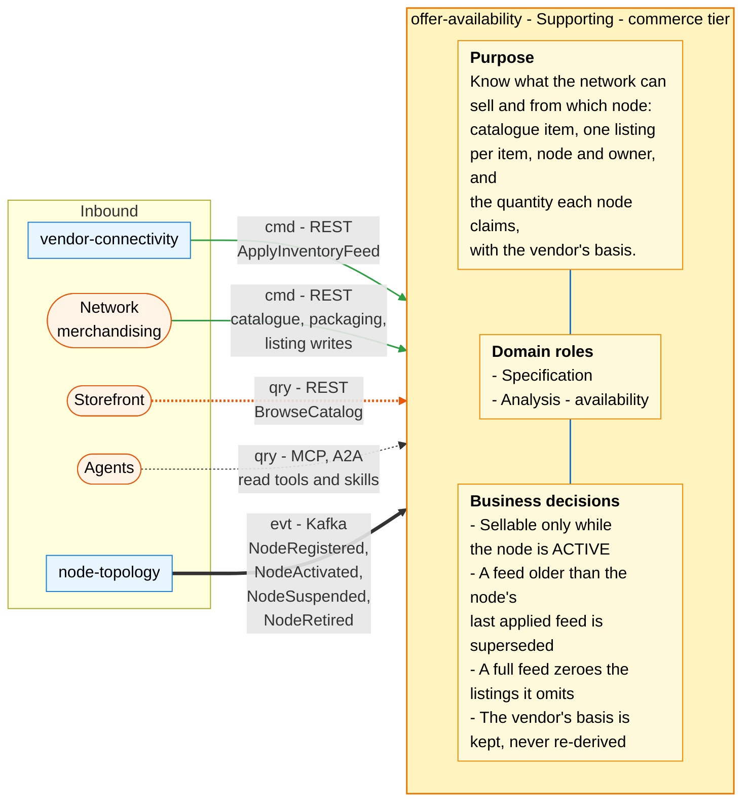
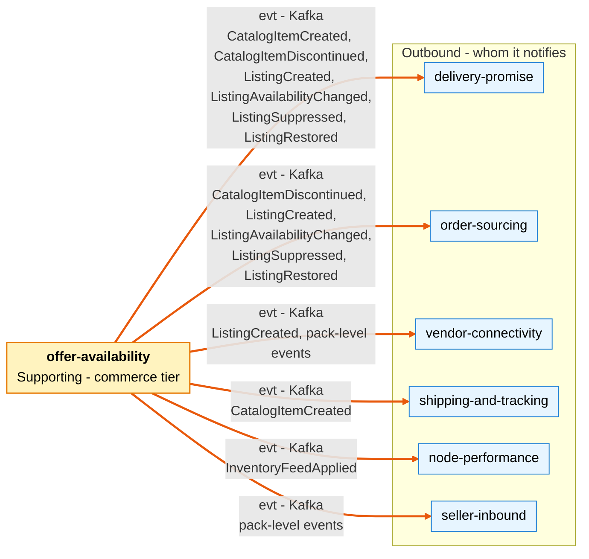

# Bounded Context Canvas

Following the ddd-crew [Bounded Context Canvas v5](https://github.com/ddd-crew/bounded-context-canvas). Every message row
is checked against the code on `develop`: routes against `apis/openapi.yaml` and
`internal/adapters/inbound/http/handlers.go`, events against `apis/asyncapi.yaml` and the `events.go` files of
`internal/domain`, the consumed side against `internal/adapters/inbound/kafka/node_consumer.go`.

## Canvas at a glance

Two pictures of the sections below: first the inbound collaborators and what the context does with them, then the
outbound collaborators it notifies. Arrows follow the message type: **solid blue** commands, **dotted green** queries,
**thick orange** events. Channel names are abbreviated; the tables carry the exact route, topic and CloudEvents type.

### Inbound

Source: `apis/openapi.yaml`, `internal/adapters/inbound/http/handlers.go`, `internal/adapters/inbound/kafka/node_consumer.go`,
`internal/adapters/inbound/mcp/tools.go`, `internal/adapters/inbound/a2a/skills.go`.

### Outbound

Source: `apis/asyncapi.yaml`, `internal/domain/{catalog,listing,feed}/events.go`,
`internal/adapters/outbound/kafka/encoder.go`; the consumer side of each edge is the aggregator's context map, not code
here. The context makes no synchronous call, so the Outbound picture has events only.

## Name

**Offer and Availability** (`offer-availability`, CloudEvents tier `commerce`, Go module
`github.com/claudioed/offer-availability`).

## Purpose

To know what the network can sell and from which node:

- the **catalogue item**, the network's own entry for a product, with its optional GTIN and packaging hierarchy;
- one **listing** per (catalogue item, node, owner);
- the **quantity** each node currently claims it can ship for each listing, with the **basis** the vendor gave for that
  number (physical stock or throughput-constrained).

It makes the facts available to the contexts that decide (promise and sourcing) as events, so their hot paths make no
synchronous call here.

## Strategic Classification

| Axis | Verdict |
| --- | --- |
| **Domain** | **Supporting**. See the [Core Domain Chart](/docs/ddd/core-domain-chart) and [Subdomain classification](/docs/ddd/subdomain-classification). |
| **Business Model** | Revenue enabler (what can be sold, from where). |
| **Evolution** | Product. |

## Domain Roles

| Role | Applies? | Evidence in the code |
| --- | --- | --- |
| **Specification** | **Yes, primary** | It defines what is sellable: `catalog.Item`, `listing.Listing`, the `LIVE` / `SUPPRESSED` rule tied to node status (`listing.ErrNodeNotSellable`, `listing.Listing.Restore`). |
| **Analysis (availability)** | **Yes** | It turns vendor feeds into per-listing availability: monotonic `asOf` (`listing.ErrStaleAvailability`), full-feed zeroing (`listing.Listing.ZeroOut`). It does not re-derive the vendor's basis. |
| Execution / Enforcer / Gateway | No | It enforces no deadline and no capacity, and it is not the vendor's entry point (`vendor-connectivity` is). |

## Inbound Communication

| Collaborator | Message | Type | Channel | Relationship |
| --- | --- | --- | --- | --- |
| `vendor-connectivity` | `ApplyInventoryFeed` | Command | REST `POST /inventory-feeds` (in-organization) | Customer/Supplier (`vendor-connectivity` is the Customer) |
| Network merchandising (human) | `CreateCatalogItem` | Command | REST `POST /catalog-items` | UI |
| Network merchandising (human) | `DiscontinueItem` | Command | REST `POST /catalog-items/{catalogItemId}:discontinue` | UI |
| Network merchandising (human) | `DeclarePackLevel`, `RetirePackLevel` | Command | REST `PUT /catalog-items/{catalogItemId}/packaging/{level}`, `POST /catalog-items/{catalogItemId}/packaging/{level}:retire` | UI |
| Network merchandising (human) | `CreateListing` | Command | REST `POST /listings` | UI |
| Storefront | `BrowseCatalog`, `GetCatalogItem` | Query | REST `GET /catalog`, `GET /catalog/{catalogItemId}` | Open Host Service |
| Any client | `ListListings`, `GetInventoryFeed` | Query | REST `GET /listings`, `GET /inventory-feeds/{feedId}` | Open Host Service |
| Agents | the four read use cases | Query | MCP tools `browse_catalog`, `get_catalog_item`, `list_listings`, `get_inventory_feed` on `cmd/mcp`; A2A skills `check_availability`, `feed_outcome` on `cmd/a2a` | Open Host Service |
| `node-topology` | `NodeRegistered` | Event | Kafka `retailnetwork.node-topology.events`, `com.retailnetwork.logistics.node-topology.node.NodeRegistered` | Conformist |
| `node-topology` | `NodeActivated` | Event | same topic, `...node.NodeActivated` | Conformist |
| `node-topology` | `NodeSuspended` | Event | same topic, `...node.NodeSuspended` | Conformist |
| `node-topology` | `NodeRetired` | Event | same topic, `...node.NodeRetired` | Conformist |

## Outbound Communication

| Collaborator | Message | Type | Channel | Relationship |
| --- | --- | --- | --- | --- |
| `delivery-promise`, `shipping-and-tracking` | `CatalogItemCreated` | Event | Kafka `retailnetwork.offer-availability.events`, `com.retailnetwork.commerce.offer-availability.catalogitem.CatalogItemCreated` | Conformist (downstream) |
| `delivery-promise`, `order-sourcing` | `CatalogItemDiscontinued` | Event | same topic, `...catalogitem.CatalogItemDiscontinued` | Conformist (downstream) |
| `seller-inbound`, `vendor-connectivity` | `CatalogItemPackagingDeclared`, `CatalogItemPackLevelRetired` | Event | same topic, `...catalogitem.CatalogItemPackagingDeclared` and `...CatalogItemPackLevelRetired` | Conformist (downstream) |
| `delivery-promise`, `order-sourcing`, `vendor-connectivity` | `ListingCreated` | Event | same topic, `...listing.ListingCreated` | Conformist (downstream) |
| `delivery-promise`, `order-sourcing` | `ListingAvailabilityChanged` | Event | same topic, `...listing.ListingAvailabilityChanged` | Conformist (downstream) |
| `delivery-promise`, `order-sourcing` | `ListingSuppressed` | Event | same topic, `...listing.ListingSuppressed` | Conformist (downstream) |
| `delivery-promise`, `order-sourcing` | `ListingRestored` | Event | same topic, `...listing.ListingRestored` | Conformist (downstream) |
| `node-performance` | `InventoryFeedApplied` | Event | same topic, `...inventoryfeed.InventoryFeedApplied` | Conformist (downstream) |
| (none) | none | Sync call | The service has no outbound client | none |

Full message details: [Domain events](/docs/ddd/domain-events). Relationship evidence: [Context map](/docs/ddd/context-map).

## Ubiquitous Language

Full glossary: [Ubiquitous language](/docs/ddd/ubiquitous-language). Top terms: **Catalog Item**, **Listing** (not a
Catalog Item), **Available Quantity**, **Availability Basis** `PHYSICAL` / `THROUGHPUT_CONSTRAINED` / `UNKNOWN`,
**Inventory Feed**, **Full Feed**, `asOf`, **Pack Level**, **GTIN**.

## Business Decisions

1. **A listing is sellable only while its node is `ACTIVE`** (`listing.Create` starts a listing `SUPPRESSED` otherwise;
   `listing.ErrNodeNotSellable`; policy `SuppressOnNodeUnavailable` in `usecases.ApplyNodeEvent`). An unknown node is
   not sellable.
2. **A feed older than the node's last applied feed is `SUPERSEDED`** (`feed.Superseded`, `node_feed_marks`); per
   listing, a line whose `asOf` is not after the current one is skipped and counted
   (`listing.ErrStaleAvailability`).
3. **A full feed zeroes every listing of that node it omits**, keeping the basis (`listing.Listing.ZeroOut`).
4. **The basis the vendor declares is kept with the number, never re-derived.**
5. **One listing per (`catalogItemId`, `nodeId`, `ownerRef`)** (`listing.ErrDuplicateListing`,
   `listings_item_node_owner_key`).
6. **A feed is applied at most once, atomically** (`feed.ErrFeedAlreadyApplied`), and every line names a listing of the
   feed's node (`feed.ErrListingNotOnNode`); a bad line fails the whole feed (`FAILED`) and changes nothing.
7. **Discontinuation is final and suppresses the item's listings** with reason `DISCONTINUED`, which no node event
   restores.
8. **A GTIN identifies one item or pack level forever** (`catalog.ErrGtinAlreadyAssigned`); a pack level above `EACH`
   needs an active lower child level (`catalog.ErrPackLevelOrder`).

## Assumptions

- `node-topology` publishes every node status change keyed by `nodeId`, so the local `node_status_view` sees them in
  order per node; an older observation is ignored anyway.
- `vendor-connectivity` checks that a vendor acts only on its own nodes before it calls `POST /inventory-feeds`; this
  context does not know vendors and has no such check.
- `vendor-connectivity` owns the asynchronous transaction, rate limits and the `202` answer to the vendor.
- Consumers of availability keep their own views from events; none calls this context on a hot path.
- Feeds and consumer inbox rows are retained 30 days, idempotency keys 24 hours
  (`internal/adapters/outbound/postgres/retention.go`).

## Verification Metrics

One instrument exists: `availability.inventory_feeds.applied` (counter, one increment per feed outcome `applied`,
`superseded`, `failed` or `rejected`, with `reason` on the last two); see
[Observability](/docs/operations/observability#metrics). Proposed, not built: apply latency percentiles, the share of
stale lines, suppression lag after `NodeSuspended` or `NodeRetired`, and outbox lag.

## Open Questions

- **Feed correlation.** Whether `feedId` is `vendor-connectivity`'s transaction id is that service's decision; this
  context accepts any well-formed id and treats a re-sent `FAILED` id as a retry.
- **Consumers are unverified here.** The downstream list is the context map's; no consumer-driven contract test exists in
  this repository ([Integration](/docs/ecosystem/integration)).
- **Atomic application at volume.** A full feed touches every listing of a node in one transaction under the node's mark
  lock; there is no measured throughput figure.
