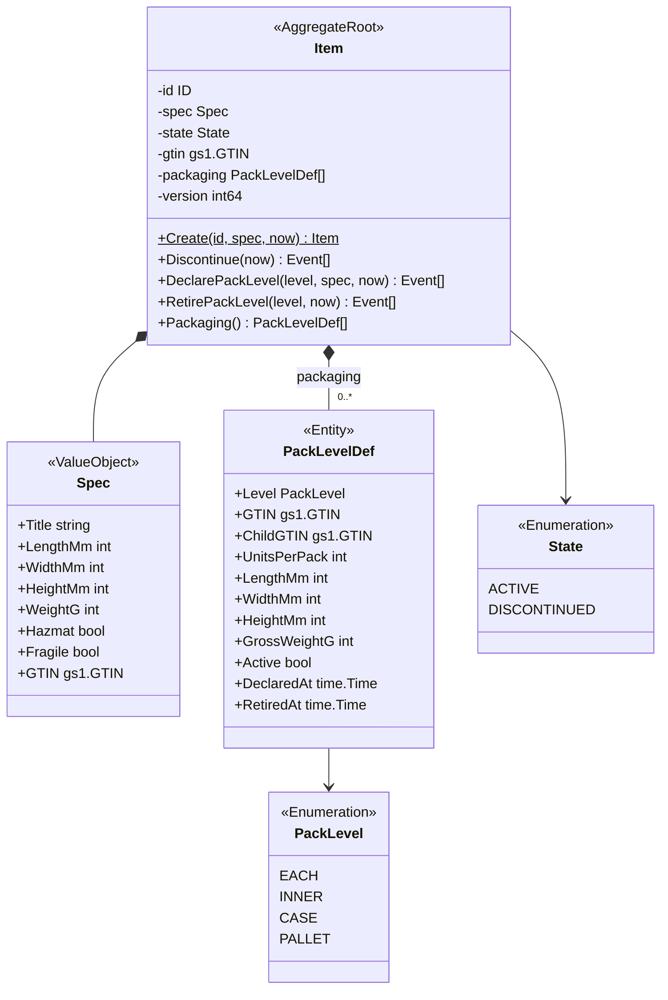
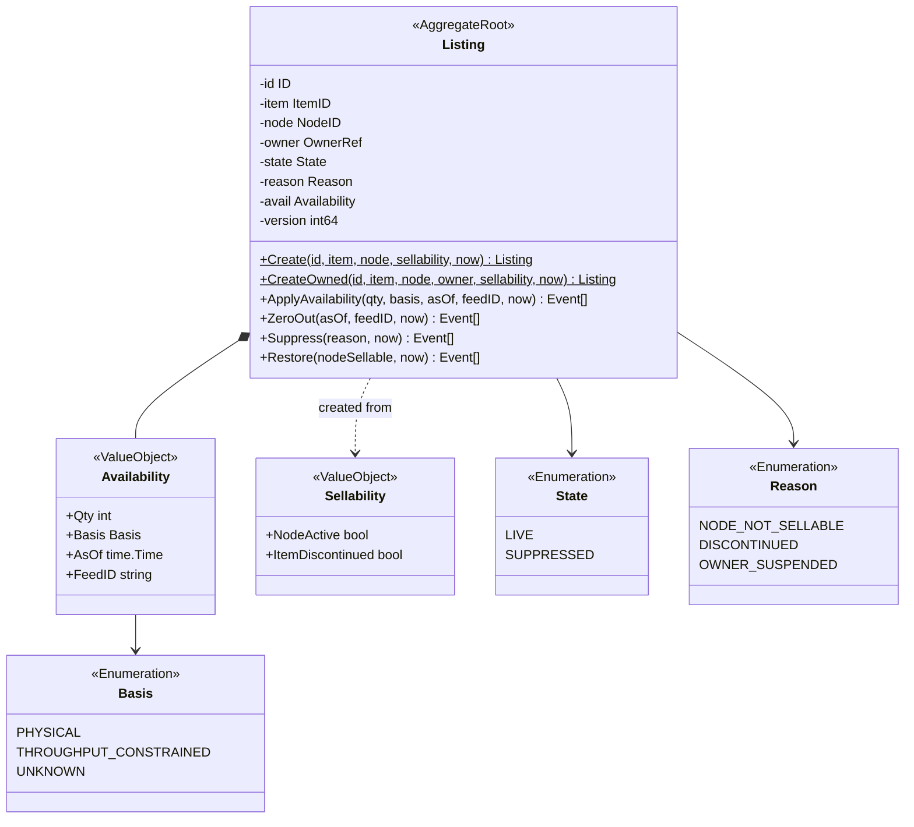
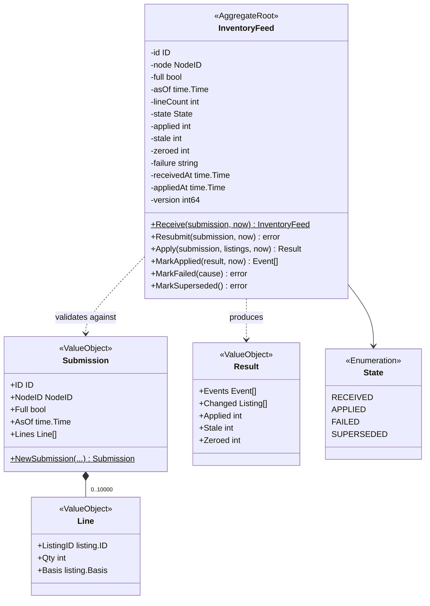
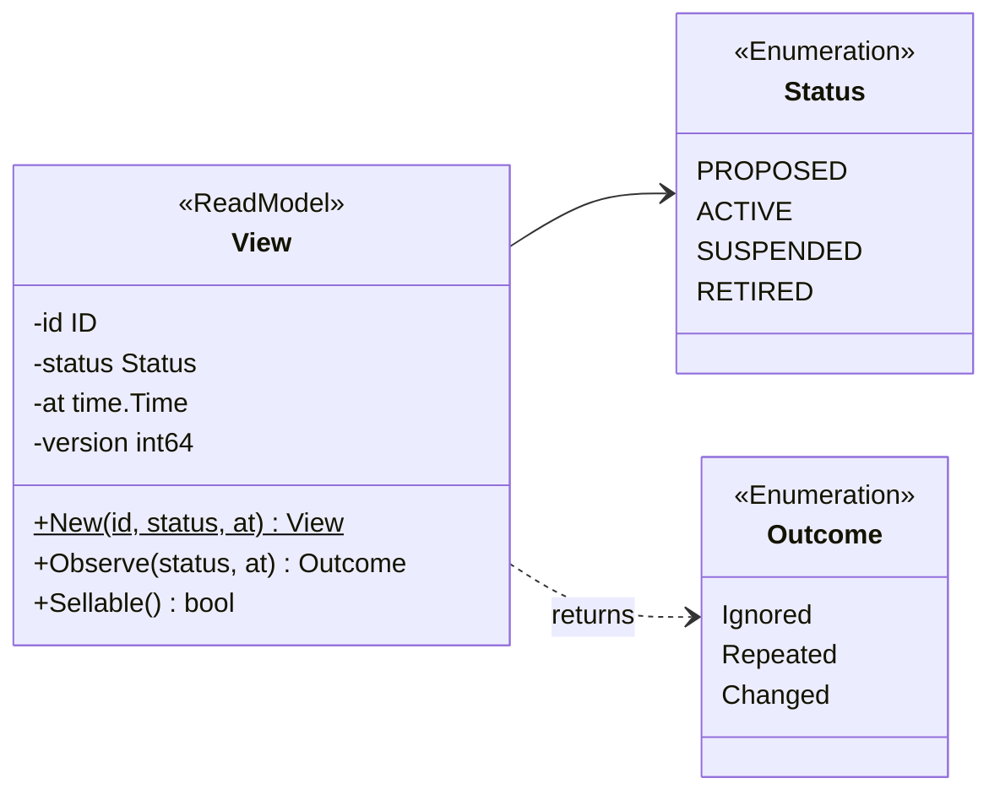
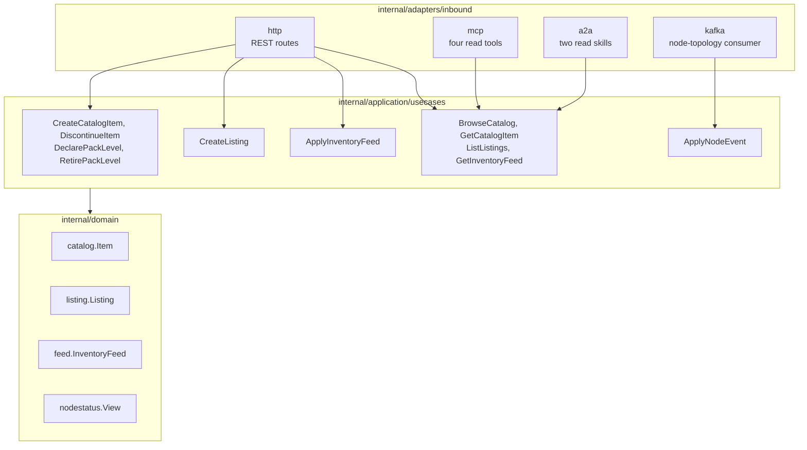
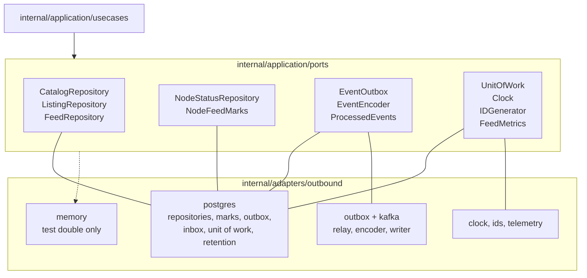

# Class Diagram

UML class diagrams of the domain packages as built, then the hexagonal ports and adapters. Names are the Go identifiers on
`develop`. Fields are shown `-` (unexported), methods `+` (exported); `$` marks a constructor. Getters, `Snapshot` and
`Restore` (rebuild from persistence, validating every invariant) exist on every aggregate and are omitted.

## 1. CatalogItem aggregate

Source: `internal/domain/catalog/catalog.go`, `internal/domain/catalog/packaging.go`.

The invariants (`ErrInvalidItemDimensions`, `ErrInvalidGTIN`, `ErrGtinAlreadyAssigned`, `ErrPackQuantityImmutable`,
`ErrPackLevelOrder`, `ErrInvalidPackQuantity`, `ErrInvalidPackDimensions`, `ErrPackLevelNotFound`) are on the
[Aggregate design canvas](/docs/ddd/aggregate-design-canvas). `gs1.GTIN` (`internal/domain/shared/gs1`) is the 14-digit
value type with the mod-10 check; `catalog.ParseGTIN` normalises 8, 12 and 13 digits to 14.

## 2. Listing aggregate

Source: `internal/domain/listing/listing.go`.

Errors: `ApplyAvailability` returns `ErrNegativeAvailability` and `ErrStaleAvailability`; `Restore` returns
`shared.ErrIllegalTransition` and `ErrNodeNotSellable`; `Suppress` returns `shared.ErrIllegalTransition`. The duplicate
check (`ErrDuplicateListing`) is made by `usecases.CreateListing` and backed by the unique key of the repository.

## 3. InventoryFeed aggregate

Source: `internal/domain/feed/feed.go`.

The feed does **not** keep its lines: `Submission` and `Line` are request values, and the persisted aggregate holds counters.
`Apply` takes the listings the use case loaded and does not touch the feed; `MarkApplied`, `MarkFailed` and `MarkSuperseded`
move the state. `feed.Superseded(asOf, lastApplied)` is the node-level staleness rule. `MarkFailed` accepts only
`ErrListingNotOnNode` and `listing.ErrNegativeAvailability` and stores the failure code.

## 3b. The node status read model

Source: `internal/domain/nodestatus/nodestatus.go`.

`Observe` ignores an observation older than the current status and anything but `RETIRED` after `RETIRED`. `Sellable`
is true only for `ACTIVE`. The policy `SuppressOnNodeUnavailable` is not a class: it is the body of
`usecases.ApplyNodeEvent` (`internal/application/usecases/node_events.go`).

## 4. Domain events

```mermaid
classDiagram
    direction LR
    class CatalogItemCreated {
        <<DomainEvent>>
        +CatalogItemID ID
        +Title string
        +LengthMm int
        +WidthMm int
        +HeightMm int
        +WeightG int
        +Hazmat bool
        +Fragile bool
        +GTIN gs1.GTIN
    }
    class CatalogItemDiscontinued {
        <<DomainEvent>>
        +CatalogItemID ID
    }
    class CatalogItemPackagingDeclared {
        <<DomainEvent>>
        +CatalogItemID ID
        +Level PackLevel
        +GTIN gs1.GTIN
        +ChildGTIN gs1.GTIN
        +UnitsPerPack int
        +DeclaredAt time.Time
    }
    class CatalogItemPackLevelRetired {
        <<DomainEvent>>
        +CatalogItemID ID
        +Level PackLevel
        +GTIN gs1.GTIN
        +RetiredAt time.Time
    }
    class ListingCreated {
        <<DomainEvent>>
        +ListingID ID
        +CatalogItemID ItemID
        +NodeID NodeID
        +OwnerRef OwnerRef
    }
    class ListingAvailabilityChanged {
        <<DomainEvent>>
        +ListingID ID
        +CatalogItemID ItemID
        +NodeID NodeID
        +OwnerRef OwnerRef
        +AvailableQty int
        +Basis Basis
        +AsOf time.Time
        +FeedID string
    }
    class ListingSuppressed {
        <<DomainEvent>>
        +ListingID ID
        +NodeID NodeID
        +Reason Reason
    }
    class ListingRestored {
        <<DomainEvent>>
        +ListingID ID
        +NodeID NodeID
    }
    class InventoryFeedApplied {
        <<DomainEvent>>
        +FeedID ID
        +NodeID NodeID
        +FullUpdate bool
        +LineCount int
        +AppliedAt time.Time
    }
```

Source: `internal/domain/catalog/events.go`, `internal/domain/listing/events.go`, `internal/domain/feed/events.go`.

Every event embeds `shared.Header{Version, At}` and implements `shared.Event` (`EventName()`, `Entity()`, `SubjectID()`,
`AggregateVersion()`, `OccurredAt()`); the CloudEvents envelope is built only in `internal/adapters/kafka/cloudevents`. The
wire fields and JSON names are on [Domain events](/docs/ddd/domain-events).

## 5. Hexagonal ports and adapters

Driving side: inbound adapters, use cases, domain.

Source: `internal/adapters/inbound/{http,mcp,a2a,kafka}`, `internal/application/usecases`, `cmd/api/run.go`, `cmd/mcp/router.go`,
`cmd/a2a/router.go`.

MCP and A2A are separate binaries (`cmd/mcp`, `cmd/a2a`) that wire only the read use cases; REST, the consumer, the relay and the
workers run in `cmd/api`.

Driven side: ports and outbound adapters.

Source: `internal/application/ports/ports.go`, `internal/adapters/outbound/{postgres,outbox,kafka,clock,ids,telemetry,memory}`.

Notes: `postgres` implements the repositories, `NodeFeedMarks` (the per-node lock, `FOR UPDATE`), the outbox
(`outbox_repository.go`), the inbox (`ProcessedEvents`) and the unit of work; `outbox/relay.go` drains `outbox_events`
through the Kafka sink (`kafka/relay_sink.go`, `writer.go`) and `kafka/encoder.go` implements `EventEncoder`. The `memory`
adapter backs unit tests only: `cmd/**` never imports it, and a fitness test enforces that
(`TestRuntimeBinaryHasNoInMemoryAdapters`). `repocontract` is the shared contract suite both stores must pass. The Kafka consumer
writes the node view through its port inside the same unit of work as the listing changes. Omitted: `cmd/` composition roots and
configuration.
