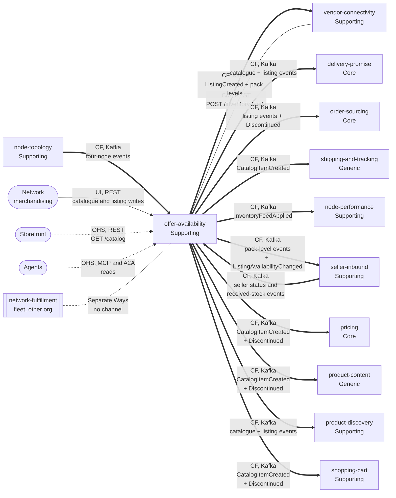

# Context Map

Following ddd-crew [Context Mapping](https://github.com/ddd-crew/context-mapping). This is **offer-availability's slice**
of the network map: every relationship this context has, with the upstream (U) and downstream (D) side, the pattern and the
channel. Patterns: OHS = Open Host Service, CF = Conformist, C/S = Customer/Supplier. The fleet-wide map is the
aggregator's [Context Map](https://iqvo.github.io/warehouse-docs/network/strategic-design/context-map).

Source: `internal/adapters/inbound/kafka/node_consumer.go`, `seller_consumer.go` and `received_consumer.go` (consumed side),
`internal/adapters/outbound/kafka/encoder.go` and `apis/asyncapi.yaml` (published side), `apis/openapi.yaml` (REST),
`cmd/mcp`, `cmd/a2a`; the downstream consumers were read on 2026-11-13 from each sibling's inbound Kafka handlers at
`origin/develop`, the other neighbour relationships are the aggregator's context map, not code in this repository.

Legend: thick arrows are Kafka events and point from the publisher to the consumer; the thin arrow is a REST call and
points from the caller to the service; dotted arrows are read-only queries into this context; the dotted line without an
arrow head is a deliberately absent relationship. Classifications follow the aggregator's
[Subdomain Classification](https://iqvo.github.io/warehouse-docs/network/strategic-design/subdomain-classification).
The `vendor-connectivity` REST edge is drawn from the caller, but this context is the upstream Supplier of that call.

Omitted: Postgres and Kafka as infrastructure, and the contexts with no relationship to this one (Separate Ways):
`customer-ordering`, `linehaul-transportation`, `last-mile-delivery`.

## Edge table

| Neighbour | Direction | Pattern | Channel | Messages | Built here? |
| --- | --- | --- | --- | --- | --- |
| `node-topology` (Supporting) | Upstream; this context is downstream | **Conformist** | Kafka `retailnetwork.node-topology.events`, `com.retailnetwork.logistics.node-topology.node.<Event>` | `NodeRegistered`, `NodeActivated`, `NodeSuspended`, `NodeRetired` | Consumer side yes (`internal/adapters/inbound/kafka/node_consumer.go`) |
| `vendor-connectivity` (Supporting) | This context upstream (Supplier); VC downstream (Customer) | **Customer/Supplier** | REST `POST /inventory-feeds`, `GET /inventory-feeds/{feedId}` | `ApplyInventoryFeed` | Server side yes; the caller is not in this repository |
| `vendor-connectivity` | This context upstream; VC downstream | **Conformist** | Kafka `retailnetwork.offer-availability.events` | `ListingCreated`, `CatalogItemPackagingDeclared`, `CatalogItemPackLevelRetired` | Publisher side yes; no consumer code here |
| `delivery-promise` (Core) | This context upstream | **Conformist** | Kafka (same topic) | `CatalogItemCreated`, `CatalogItemDiscontinued`, `ListingCreated`, `ListingAvailabilityChanged`, `ListingSuppressed`, `ListingRestored` | Publisher side only |
| `order-sourcing` (Core) | This context upstream | **Conformist** | Kafka (same topic) | `CatalogItemDiscontinued`, `ListingCreated`, `ListingAvailabilityChanged`, `ListingSuppressed`, `ListingRestored` | Publisher side only |
| `shipping-and-tracking` (Generic) | This context upstream | **Conformist** | Kafka (same topic) | `CatalogItemCreated` | Publisher side only |
| `node-performance` (Supporting) | This context upstream | **Conformist** | Kafka (same topic) | `InventoryFeedApplied` | Publisher side only |
| `seller-inbound` (Supporting) | This context upstream | **Conformist** | Kafka (same topic) | `CatalogItemPackagingDeclared`, `CatalogItemPackLevelRetired`, `ListingAvailabilityChanged` | Publisher side only |
| `seller-inbound` | Upstream; this context is downstream | **Conformist** | Kafka `retailnetwork.seller-inbound.events`, `com.retailnetwork.partner.seller-inbound.<entity>.<Event>` | `SellerSuspended`, `SellerReinstated`, `InboundShipmentReceived` | Consumer side yes (`internal/adapters/inbound/kafka/seller_consumer.go`, `received_consumer.go`) |
| `pricing` (Core) | This context upstream | **Conformist** | Kafka (same topic) | `CatalogItemCreated`, `CatalogItemDiscontinued` | Publisher side only |
| `product-content` (Generic) | This context upstream | **Conformist** | Kafka (same topic) | `CatalogItemCreated`, `CatalogItemDiscontinued` | Publisher side only |
| `product-discovery` (Supporting) | This context upstream | **Conformist** | Kafka (same topic) | `CatalogItemCreated`, `CatalogItemDiscontinued`, `ListingCreated`, `ListingAvailabilityChanged`, `ListingSuppressed`, `ListingRestored` | Publisher side only |
| `shopping-cart` (Supporting) | This context upstream | **Conformist** | Kafka (same topic) | `CatalogItemCreated`, `CatalogItemDiscontinued` | Publisher side only |
| Network merchandising (human) | This context upstream | **UI** | REST `POST /catalog-items`, `POST /catalog-items/{catalogItemId}/discontinuations`, packaging routes, `POST /listings` | `CreateCatalogItem`, `DiscontinueItem`, `DeclarePackLevel`, `RetirePackLevel`, `CreateListing` | Yes |
| Storefront | This context upstream | **Open Host Service** | REST `GET /catalog`, `GET /catalog/{catalogItemId}`, `GET /listings` | `BrowseCatalog`, `GetCatalogItem`, `ListListings` | Yes |
| Agents | This context upstream | **Open Host Service** | MCP `cmd/mcp` (four read-only tools), A2A `cmd/a2a` (skills `check_availability`, `feed_outcome`) | the read use cases | Yes |
| `network-fulfillment` (fleet, other organisation) | none | **Separate Ways** | none | none | Not applicable |

The downstream consumer lists were recomputed on 2026-11-13 from each sibling's inbound Kafka handlers at `origin/develop`;
this repository publishes the events, holds no consumer of its own events and no contract test against a consumer
([Integration](/docs/ecosystem/integration)). The type-by-consumer table is on
[Domain events](/docs/ddd/domain-events).

## Notes on the patterns

- **Conformist downstream, no Published Language claimed.** Every consumer of this context's events takes them as
  published. The CloudEvents envelope and `dataschema` URNs are the fleet convention
  (`internal/adapters/kafka/cloudevents`), but the topic is not declared a Published Language, so this page does not
  either.
- **Customer/Supplier with `vendor-connectivity`.** The `POST /inventory-feeds` contract is in-organization and
  synchronous; both sides can shape it, `vendor-connectivity` is the Customer. This service does not authenticate the
  caller (REST is unauthenticated fleet-wide).
- **No Anti-Corruption Layer here.** The vendor's vocabulary is translated in `vendor-connectivity`; by the time a feed
  arrives it speaks `listingId`, `availableQty` and `basis`.
- **No Shared Kernel.** `nodeId`, `catalogItemId` and `listingId` cross boundaries by value only; the domain packages
  import nothing from a neighbour (the node status is restated in `internal/domain/nodestatus`).
- **No sibling calls.** The service has no outbound REST, MCP or A2A client.

## Packaging and seller-inbound

The packaging hierarchy and the optional listing `ownerRef` came with
[ADR 0006](/docs/adr/0006-catalog-gtin-packaging-and-listing-owner) (the realisation of the aggregator's
[ADR 0009](https://iqvo.github.io/warehouse-docs/network/adr/0009-seller-inbound-and-case-packed-shipments)). They add
the `seller-inbound` edge and the pack-level events to the `vendor-connectivity` edge in the table above. The reverse edge,
`seller-inbound` upstream with `SellerSuspended`, `SellerReinstated` and `InboundShipmentReceived`, came with
[ADR 0013](/docs/adr/0013-seller-status-and-received-stock-drive-owner-listings) and
[ADR 0014](/docs/adr/0014-received-stock-creates-owner-listings).
