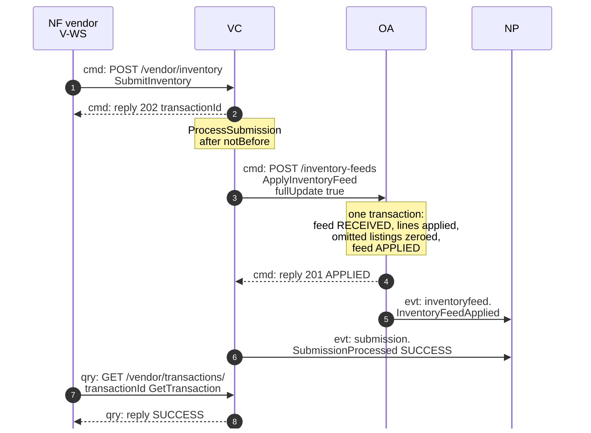
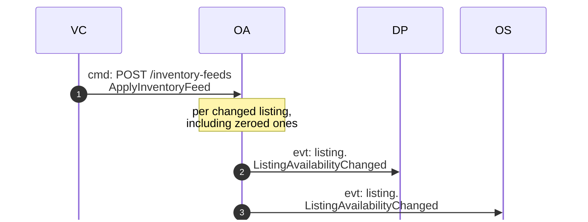
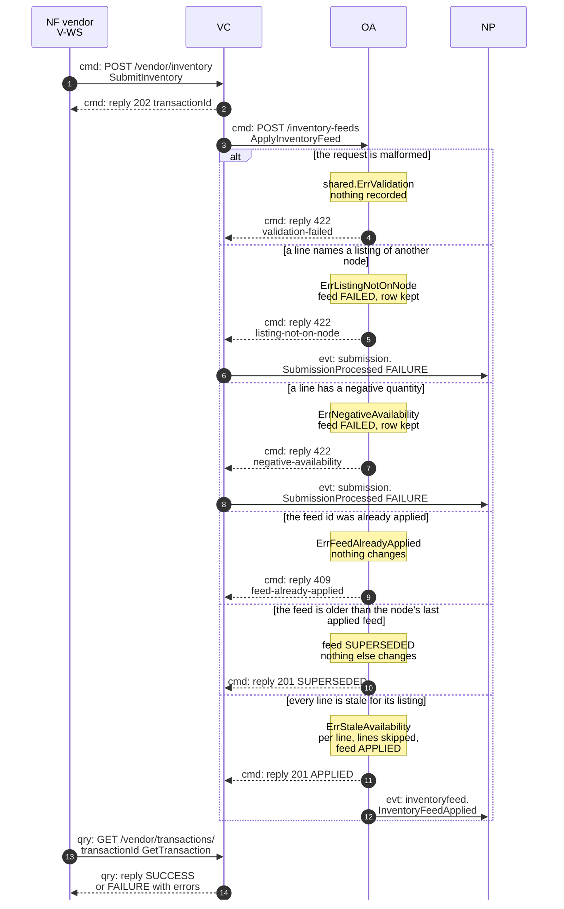
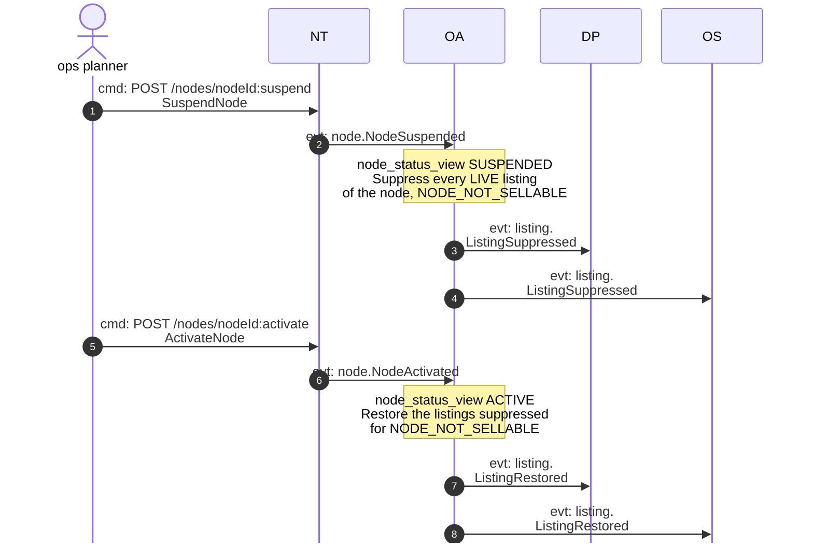
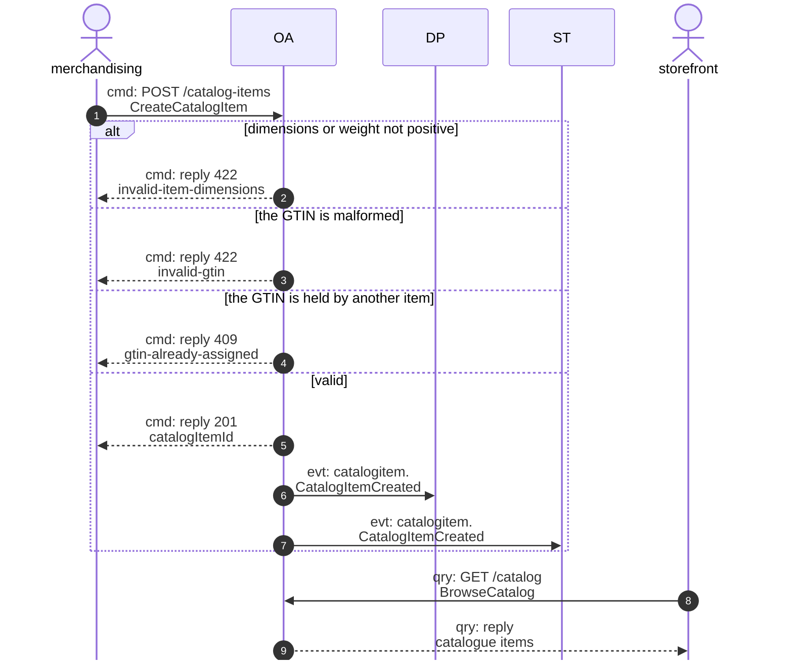
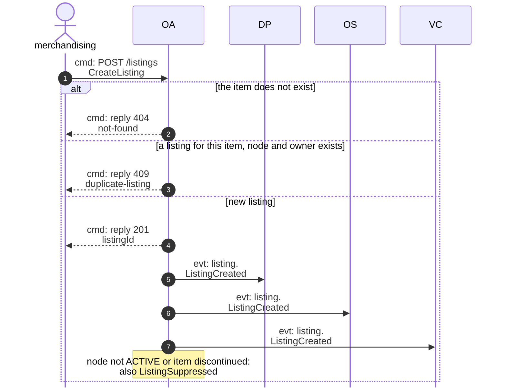
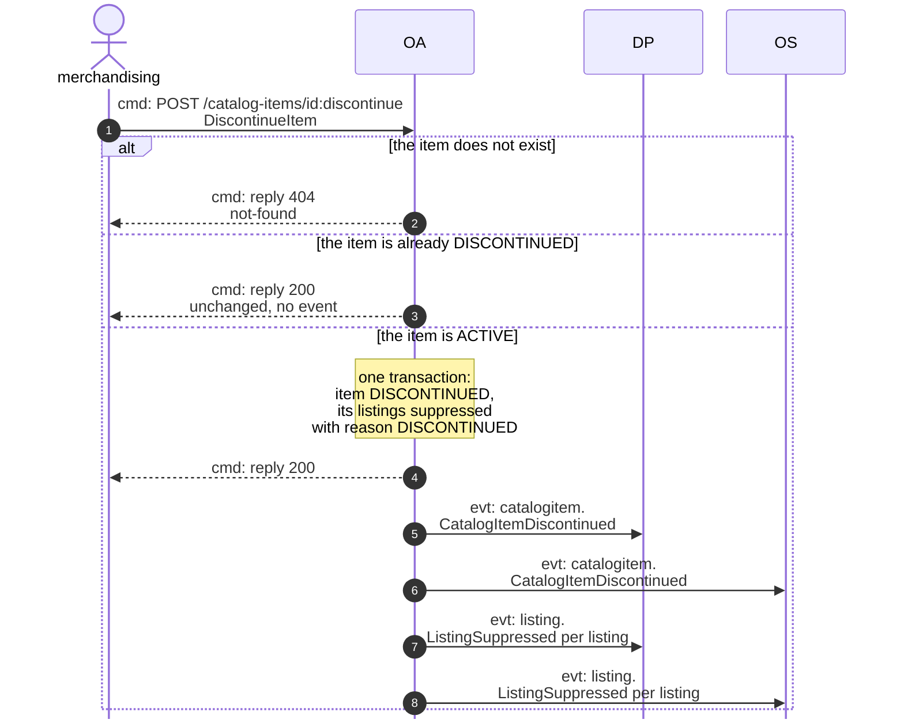

# Domain Message Flow

Following ddd-crew [Domain Message Flow Modelling](https://github.com/ddd-crew/domain-message-flow-modelling). Five scenarios.
Participants are contexts and actors, abbreviated by context code: NF = `network-fulfillment` (the fleet, vendor V-WS), VC =
`vendor-connectivity`, OA = `offer-availability`, NT = `node-topology`, DP = `delivery-promise`, OS = `order-sourcing`, ST =
`shipping-and-tracking`, NP = `node-performance`. Every arrow is a message prefixed `cmd:` (command), `qry:` (query) or
`evt:` (event). Event arrows are written `<entity>.<EventName>`; the full type is
`com.retailnetwork.<tier>.<producer>.<entity>.<EventName>` (see [Domain events](/docs/ddd/domain-events)). Path parameters are
written without braces. The OA side of every flow is checked against the code; the VC, NT, DP, OS, ST and NP sides are the
aggregator's description of those contexts, not code in this repository. The domain-wide flows are on the aggregator's
[Domain Message Flows](https://iqvo.github.io/warehouse-docs/network/strategic-design/domain-message-flows).

## 1. A full inventory feed is applied (happy path)

Source: `internal/application/usecases/feeds.go` (`ApplyInventoryFeed`), `internal/domain/feed/feed.go` (`Apply`,
`MarkApplied`), `internal/adapters/inbound/http/handlers.go`; the vendor-facing messages are `vendor-connectivity`'s.

The same apply, seen from the availability consumers:

Source: `internal/domain/feed/feed.go` (`Apply`, `zeroOmitted`), `internal/domain/listing/events.go`.

Omitted: `vendor-connectivity`'s ownership check and rate limiting; the outbox relay between commit and Kafka, so the event
arrows can be seen after the reply; the lines that were stale, which raise no event. One `ListingAvailabilityChanged` goes out
per changed listing; the diagram shows one arrow per consumer. A partial feed is the same flow without zeroing.

## 2. A feed is refused, superseded or changes nothing (failure path)

Source: `internal/application/usecases/feeds.go`, `internal/domain/feed/feed.go` (`NewSubmission`, `Superseded`, `MarkFailed`,
`MarkSuperseded`), `internal/adapters/inbound/http/problems.go` (problem slugs and statuses).

Omitted: what `vendor-connectivity` does with a `409` on a feed it already applied, and with a `SUPERSEDED` answer. A `FAILED`
feed id may be sent again; an `APPLIED` or `SUPERSEDED` one may not. A superseded or failed feed publishes no
`InventoryFeedApplied`; the counter `availability.inventory_feeds.applied` records every outcome.

## 3. A node is suspended, then activated again

Source: `internal/adapters/inbound/kafka/node_consumer.go`, `internal/application/usecases/node_events.go` (`ApplyNodeEvent`),
`internal/domain/nodestatus/nodestatus.go`; the node commands are `node-topology`'s.

Omitted: one `ListingSuppressed` or `ListingRestored` goes out per listing; the diagram shows one arrow per consumer. A listing
suppressed for `DISCONTINUED` is never restored. `NodeRetired` follows the first half of this flow and no later event
changes a retired node. A redelivered event (same CloudEvents `id`) is skipped through `processed_events`.

## 4. A catalogue item is created, listed and browsed

Source: `internal/application/usecases/catalog.go` (`CreateCatalogItem`), `internal/application/usecases/queries.go`
(`BrowseCatalog`), `internal/adapters/inbound/http/handlers.go`.

Then the item is listed on a node:

Source: `internal/application/usecases/listings.go` (`CreateListing`), `internal/domain/listing/listing.go` (`CreateOwned`).

A new listing has quantity 0 and basis `UNKNOWN` until the node's first feed names it. An unknown node is not sellable, so a
listing on a node `node-topology` has not yet announced starts `SUPPRESSED`.

## 5. A catalogue item is discontinued

Source: `internal/application/usecases/catalog.go` (`DiscontinueItem`), `internal/domain/catalog/catalog.go` (`Discontinue`),
`internal/domain/listing/listing.go` (`Suppress`).

The events leave in the order `CatalogItemDiscontinued`, then `ListingSuppressed` by listing id. A later `NodeActivated` never
restores these listings.
