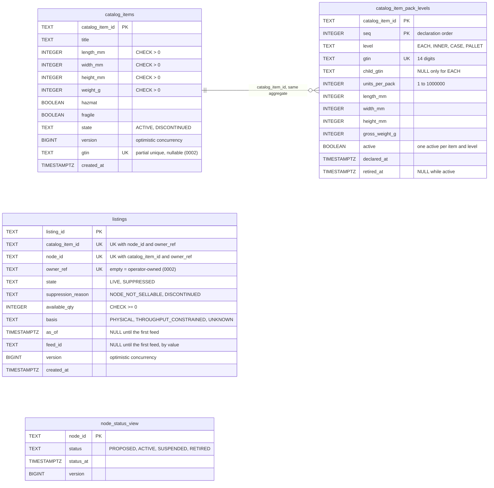
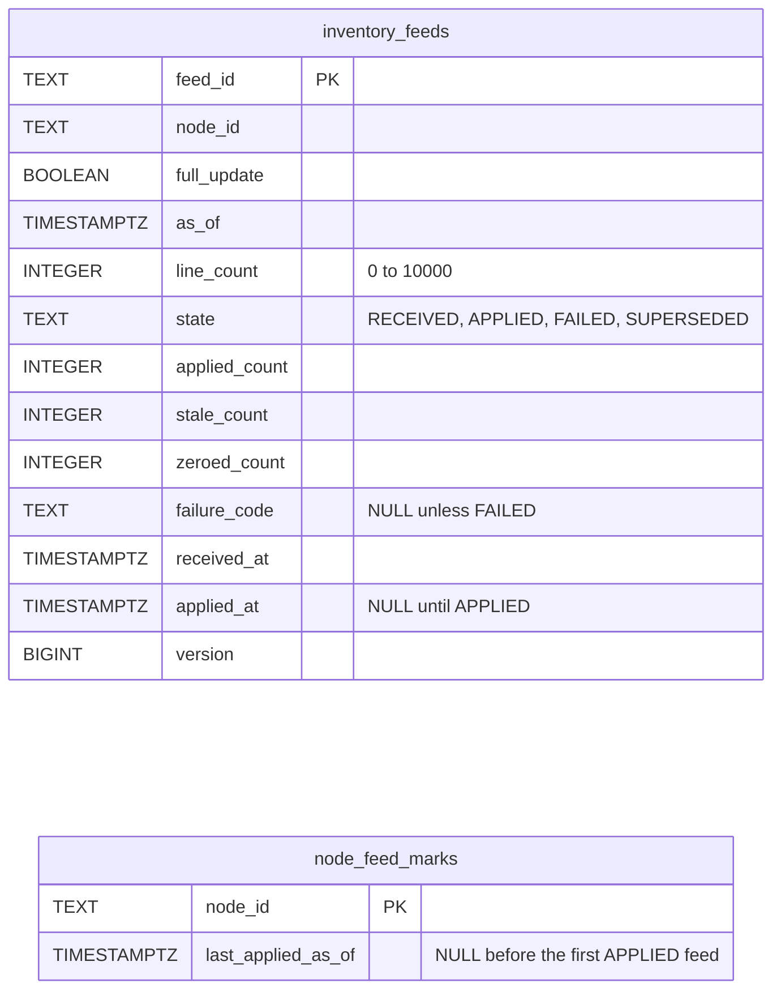
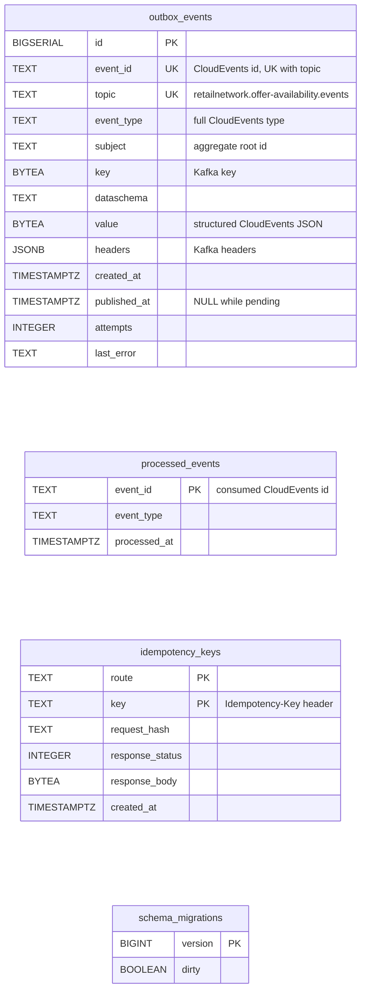

# Entity Relationship

The Postgres schema as `migrations/0001_offer_availability_schema.up.sql` and
`0002_catalog_packaging_and_listing_owner.up.sql` create it (both under
`internal/adapters/outbound/postgres/migrations/`, embedded in the binary and applied by
`postgres.RunMigrations`). This context owns its database and shares no table with a neighbour. There are **nine** tables
plus `schema_migrations`, the bookkeeping table of golang-migrate, which no migration file creates. Ids are
`TEXT COLLATE "C"` so keyset pages order the same in Postgres and in the in-memory doubles; instants are `timestamptz`.

## Aggregate and read-model tables

Source: `internal/adapters/outbound/postgres/migrations/0001_offer_availability_schema.up.sql` and
`0002_catalog_packaging_and_listing_owner.up.sql`.

`node_status_view` is the local copy of `node-topology`'s node status, fed by the consumer
([ADR 0003](/docs/adr/0003-consumed-contracts-and-local-node-status)); the code maps it from `nodestatus.View`
(`internal/adapters/outbound/postgres/node_status_repository.go`). The only relationship line is the one inside the
`CatalogItem` aggregate; `catalog_item_pack_levels` carries no foreign key constraint, the link is the shared
`catalog_item_id`.

Constraints worth knowing that the diagram cannot show:

- `listings_state_reason`: `state = 'SUPPRESSED'` exactly when `suppression_reason IS NOT NULL`.
- `listings_as_of_feed`: `as_of` and `feed_id` are both null or both set.
- `listings_item_node_owner_key` (`catalog_item_id, node_id, owner_ref`) backs `listing.ErrDuplicateListing`;
  migration 0002 replaced `listings_item_node_key` with it. `idx_listings_node (node_id, listing_id)` serves the
  full-feed zeroing and `GET /listings?nodeId=`.
- `catalog_items_gtin_key` (partial unique index on `gtin`) and `catalog_item_pack_levels_gtin_key` (`UNIQUE (gtin)`)
  keep one GTIN on one thing forever; `catalog_item_pack_levels_active_key` allows one active definition per item and
  level; `catalog_item_pack_levels_retired` ties `active` to `retired_at IS NULL`; `catalog_item_pack_levels_each`
  makes `child_gtin` null exactly for `EACH`.

## The InventoryFeed aggregate

Source: `internal/adapters/outbound/postgres/migrations/0001_offer_availability_schema.up.sql`,
`internal/adapters/outbound/postgres/feed_repository.go`.

The feed has **no lines table**: it keeps counters only (`applied_count`, `stale_count`, `zeroed_count`), never the
lines. `node_feed_marks` holds, per node, the `asOf` of the last `APPLIED` feed (the staleness rule that makes a
feed `SUPERSEDED`); the row also serves as the lock that serialises the feeds of one node. `idx_inventory_feeds_received
(received_at)` serves the 30-day retention purge.

## Infrastructure tables

Source: `internal/adapters/outbound/postgres/migrations/0001_offer_availability_schema.up.sql`,
`internal/adapters/outbound/postgres/migrate.go`.

**Infrastructure, not domain.** `outbox_events` is the transactional outbox: a row is one already-encoded Kafka
message, inserted in the same transaction as the aggregate change, drained by the relay
(`internal/adapters/outbound/outbox/relay.go`); the partial index `idx_outbox_events_unpublished` keeps the scan of
the pending tail small. `processed_events` is the inbox of the `node-topology` consumer.
`idempotency_keys` stores the answer of a state-changing REST call for 24 hours. `schema_migrations` is
golang-migrate's own table.

Retention (`internal/adapters/outbound/postgres/retention.go`): `idempotency_keys` 24 hours, `inventory_feeds` 30 days
(by `received_at`), `processed_events` 30 days. Published `outbox_events` rows are not purged by this code.

## Why there are no foreign keys across aggregates or contexts

The migrations declare no `FOREIGN KEY` at all; aggregates reference each other by value
([ADR 0002](/docs/adr/0002-aggregates-and-invariants)).

- `listings.catalog_item_id` points at `catalog_items`, a different aggregate. `CreateListing` checks the item in its
  own transaction instead.
- `listings.feed_id` points at `inventory_feeds`, which is retained 30 days while listings live on; a key would break
  on retention.
- `listings.node_id`, `inventory_feeds.node_id`, `node_feed_marks.node_id` and `node_status_view.node_id` name a node
  that belongs to `node-topology`'s database. `node_status_view` is a local copy fed by events and never the target
  of a key.
- `outbox_events.key` and `subject` hold the aggregate root id for Kafka, they are not references.

## Table is not aggregate

| Table | Aggregate / role | Notes |
| --- | --- | --- |
| `catalog_items` | **CatalogItem** (root) | One row per item; `version` checked on update; `gtin` is the each-level GTIN. |
| `catalog_item_pack_levels` | **CatalogItem** (its packaging) | Every level ever declared, retired ones included (`active = false`). |
| `listings` | **Listing** (root), with the `Availability` value object flattened into columns | Unique key backs `ErrDuplicateListing`; `CHECK available_qty >= 0` repeats `ErrNegativeAvailability`. |
| `inventory_feeds` | **InventoryFeed** (root) | Counters only; retained 30 days. |
| `node_feed_marks` | Part of the feed-application protocol | Per-node staleness mark and lock. |
| `node_status_view` | none (read model `nodestatus.View`) | Fed from `retailnetwork.node-topology.events`. |
| `outbox_events` | none (infrastructure) | Transactional outbox. |
| `processed_events` | none (infrastructure) | Consumer inbox. |
| `idempotency_keys` | none (infrastructure) | REST replay store. |
| `schema_migrations` | none (infrastructure) | Migration bookkeeping, not in a migration file. |
