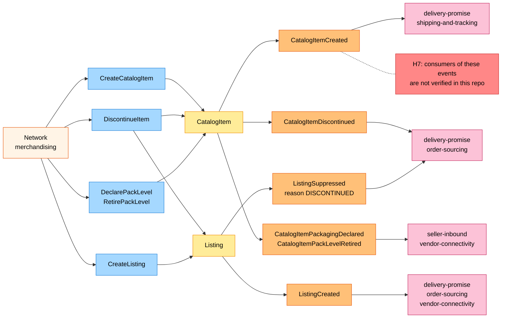
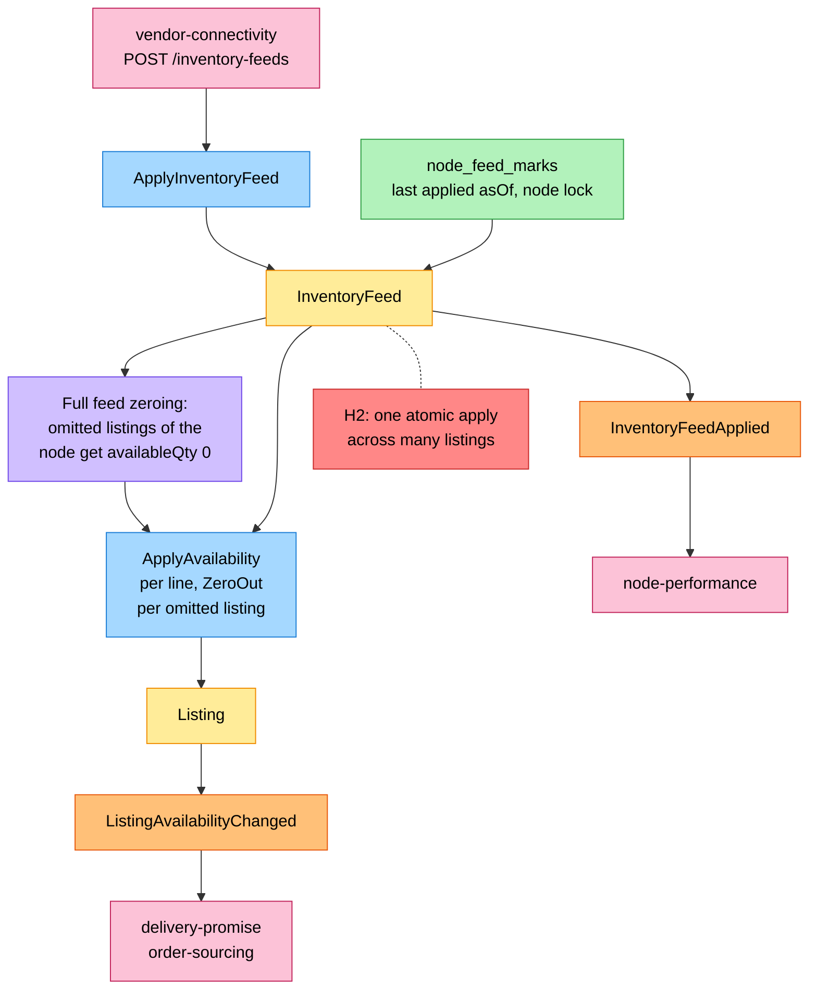
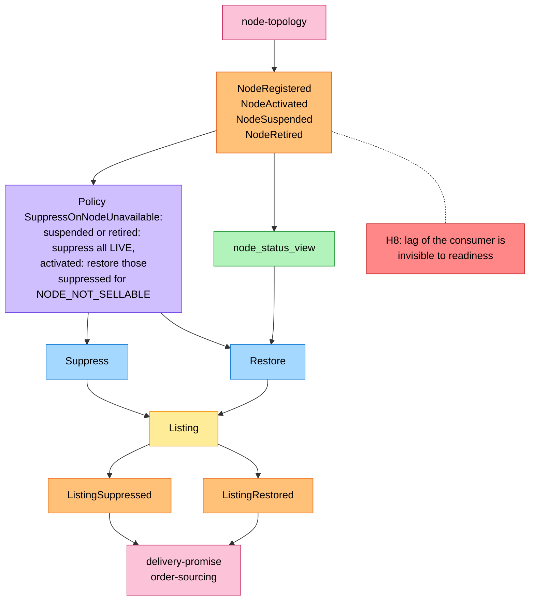

# EventStorming

Process-level boards (`flowchart LR`, or `TB` where LR would be too wide) in the ddd-crew
[EventStorming glossary & cheat sheet](https://github.com/ddd-crew/eventstorming-glossary-cheat-sheet) notation. Every sticky is
a command, aggregate, event, policy, read model or neighbour that exists in the code on `develop`. The hotspots are the gaps
the design left open: most are now settled by the code and the table at the end says how, the rest are still risks. The
domain-wide board is the aggregator's
[EventStorming Big Picture](https://iqvo.github.io/warehouse-docs/network/strategic-design/eventstorming-big-picture).

## Legend

| Sticky | Colour | Meaning |
| --- | --- | --- |
| Command | blue `#a5d8ff` | An intention, named as the use case or aggregate method |
| Aggregate | yellow `#ffec99` | The aggregate root that decides |
| Domain Event | orange `#ffc078` | A fact this context publishes (or a consumed one) |
| Policy | lilac `#d0bfff` | "Whenever X, then Y" |
| Read Model | green `#b2f2bb` | A local, event-fed view |
| External System | pink `#fcc2d7` | A neighbouring context or the fleet |
| Hotspot | red `#ff8787` | A remaining risk or an open question |
| Actor | pale orange `#fff4e6` | A person (used only for humans) |

## 1. Catalogue and listing set-up

Source: `internal/application/usecases/catalog.go`, `internal/application/usecases/listings.go`,
`internal/domain/catalog/events.go`, `internal/domain/listing/events.go`.

Omitted: the refusals (`invalid-item-dimensions`, `invalid-gtin`, `gtin-already-assigned`, `duplicate-listing`; see
[Use cases](/docs/ddd/use-cases)) and the read queries, which change nothing. `CreateListing` also raises `ListingSuppressed`
when the node is not `ACTIVE` or the item is discontinued.

## 2. Inventory feed application

Source: `internal/application/usecases/feeds.go`, `internal/domain/feed/feed.go`, `internal/domain/listing/listing.go`,
`internal/adapters/outbound/postgres/feed_repository.go` (`node_feed_marks`).

Omitted: the `FAILED` outcome (`listing-not-on-node`, `negative-availability`) and the `SUPERSEDED` outcome, which raise no event
but increment the feed counter; the stale-line skip, which raises no `ListingAvailabilityChanged`; the vendor's own Vendor API
submission upstream of `vendor-connectivity`.

## 3. Node-driven suppression

Source: `internal/application/usecases/node_events.go`, `internal/domain/nodestatus/nodestatus.go`,
`internal/adapters/inbound/kafka/node_consumer.go`.

Omitted: `NodeRegistered` only inserts the node into the view as `PROPOSED` (a no-op for a known node) and triggers no command.
`Restore` takes the node's sellability from the view and is refused with `ErrNodeNotSellable` on a node that is not `ACTIVE`; a
`DISCONTINUED` listing is never restored.

## Hotspots

H1 to H6 were open questions of the design that the code has since settled; H2, H7 and H8 remain.

| Hotspot | Question | Status in the code |
| --- | --- | --- |
| H1 | A feed older than the node's last applied feed has no rule or state | Settled: state `SUPERSEDED`, `feed.Superseded`, the `node_feed_marks` table |
| H2 | A full feed writes every listing of a busy node in one atomic apply (up to 10000 lines) | **Open.** One transaction under the node's lock; no measured limit on transaction size or lock time |
| H3 | Starting state and availability of a new listing | Settled: `LIVE` only when the node is `ACTIVE` and the item is not discontinued, else `SUPPRESSED`; quantity 0, basis `UNKNOWN` |
| H4 | Effect of discontinuing on the item's listings | Settled: every listing is suppressed with reason `DISCONTINUED`, finally |
| H5 | What a zeroed listing carries | Settled: quantity 0, the basis kept, the feed's `asOf` and id stamped |
| H6 | Vocabulary of the suppression reason | Settled: `NODE_NOT_SELLABLE` and `DISCONTINUED` (`listing.Reason`) |
| H7 | The downstream consumers are named by the aggregator, not by a contract test here | **Open.** [Integration](/docs/ecosystem/integration) |
| H8 | While the node-topology consumer lags, listings keep their last state and `/readyz` stays green | **Open.** Readiness checks Postgres and a broker, not consumer lag ([Troubleshooting](/docs/operations/troubleshooting#kafka-the-outbox-and-the-consumer)) |
