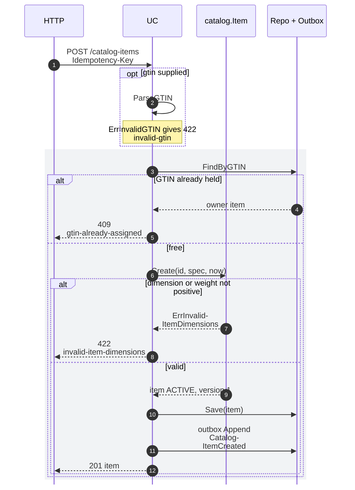
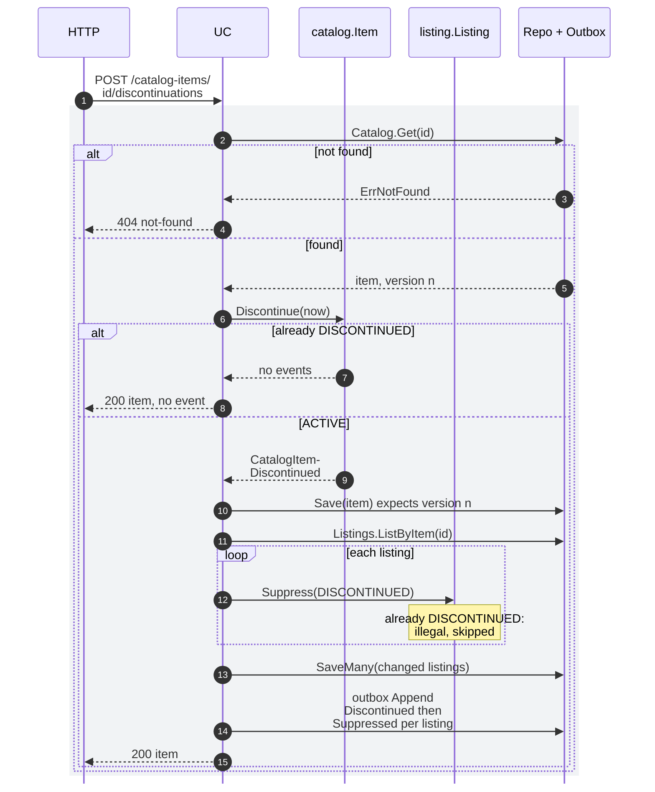
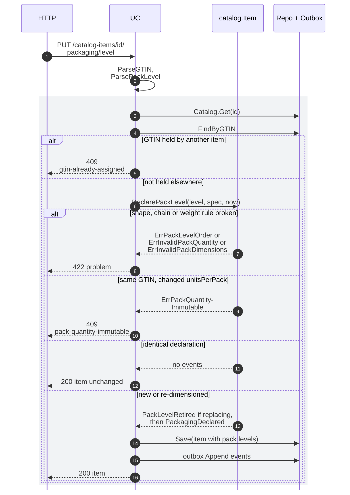
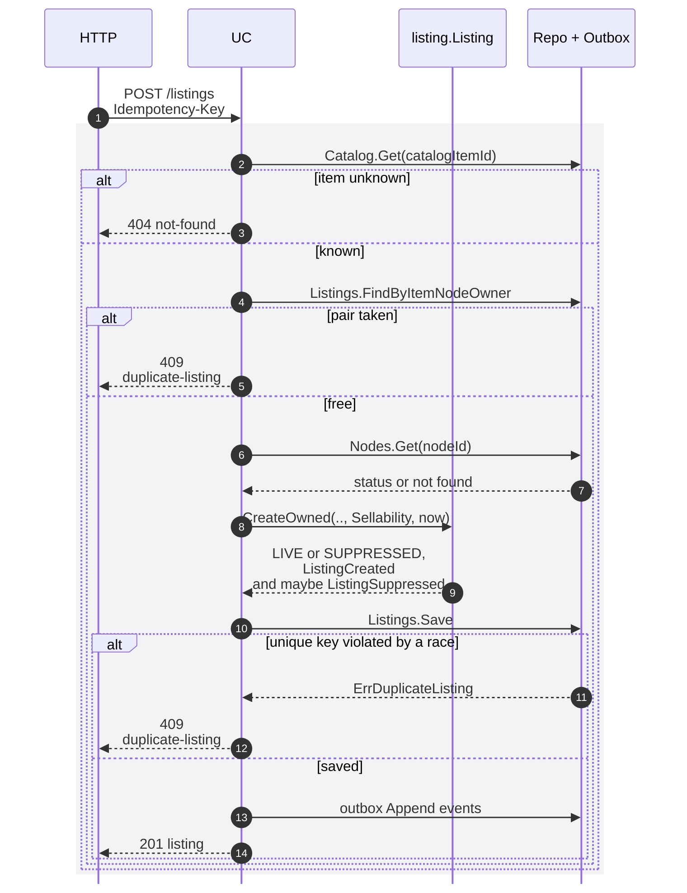
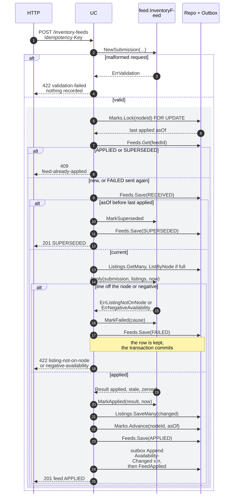
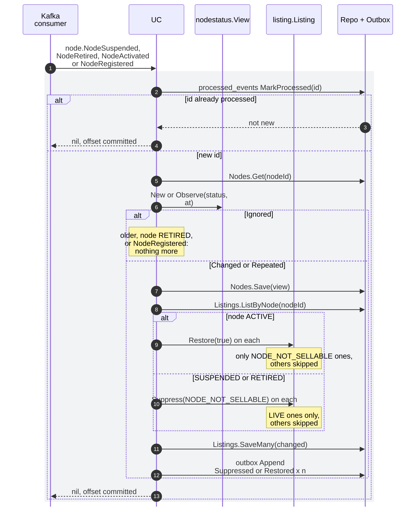
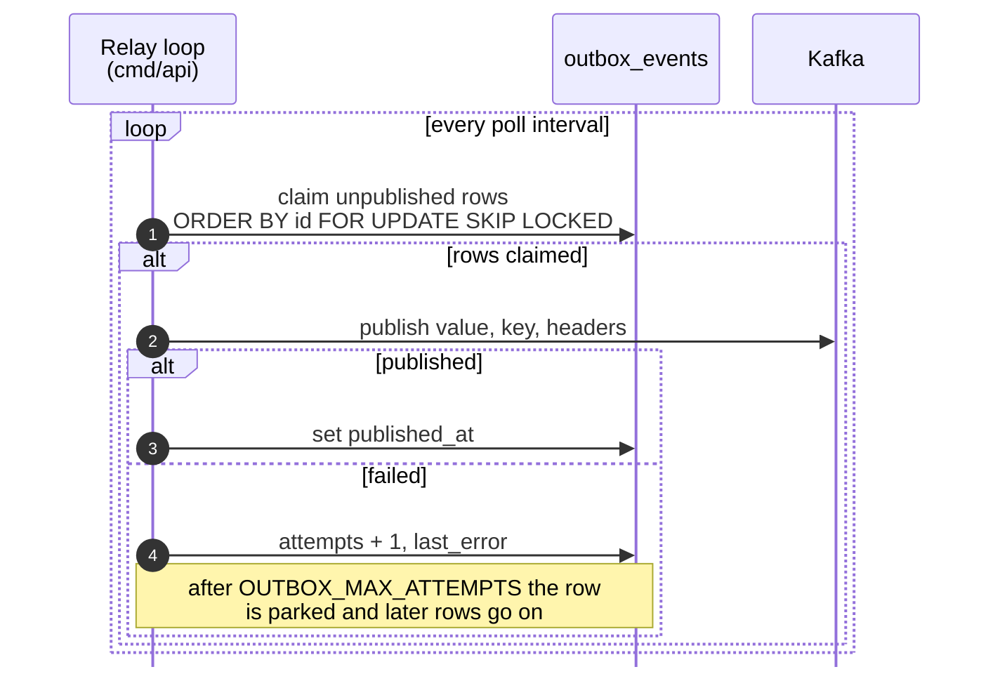

# Sequence Diagrams

One sequence diagram per write use case of [Use cases](/docs/ddd/use-cases), plus the outbox relay. Participants, in order: the
inbound adapter (`HTTP`, or the Kafka consumer `KC`), the use case (`UC`), the aggregate, the database (`DB`) and, where it
matters, Kafka. The grey `rect` is one database transaction: the repositories, the outbox rows and, for the consumer, the
`processed_events` row are written in it, so they commit or roll back together. Messages to `DB` that start with "outbox" are
outbox writes, the others are repository calls. A hyphen before a line break splits a long name to keep the diagram narrow
(`Catalog-ItemCreated` is `CatalogItemCreated`).

Common to every REST write: the `Idempotency-Key` middleware (`internal/adapters/inbound/http/idempotency.go`) runs first. A
key already stored for the route replays the first answer with `Idempotency-Replayed: true`, a new key is recorded in
`idempotency_keys` in the same transaction as the use case. Common to every use case: `transact` runs the whole attempt a
second time when it meets `ports.ErrConcurrentUpdate`, and reports `concurrent-update` (409) only if it happens again. Event
arrows to Kafka name `<entity>.<EventName>` on `retailnetwork.offer-availability.events`; the full type is
`com.retailnetwork.commerce.offer-availability.<entity>.<EventName>`.

## 1. CreateCatalogItem

Source: `internal/application/usecases/catalog.go` (`CreateCatalogItem`), `internal/domain/catalog/catalog.go` (`Create`),
`internal/adapters/inbound/http/problems.go`.

Omitted: the idempotency-key write (same transaction), logging and tracing. A failure rolls the transaction back, so no outbox
row exists for it.

## 2. DiscontinueItem

Source: `internal/application/usecases/catalog.go` (`DiscontinueItem`, `suppressListings`), `internal/domain/listing/listing.go`
(`Suppress`).

Omitted: the idempotency replay. A version conflict on `Save` makes `transact` retry once, then answers `409 concurrent-update`.

## 3. DeclarePackLevel

Source: `internal/application/usecases/catalog.go` (`DeclarePackLevel`), `internal/domain/catalog/packaging.go`
(`DeclarePackLevel`, `redeclare`, `checkChain`).

`RetirePackLevel` is the same shape: it retires the active definition at the level and raises `CatalogItemPackLevelRetired`,
returns the item unchanged for a level with only retired history, and answers `404 pack-level-not-found` for a level never declared.

## 4. CreateListing

Source: `internal/application/usecases/listings.go` (`CreateListing`), `internal/domain/listing/listing.go` (`CreateOwned`).

Omitted: the idempotency replay. An unknown node counts as not sellable, so the listing starts `SUPPRESSED` with reason
`NODE_NOT_SELLABLE`; a discontinued item wins with `DISCONTINUED`.

## 5. ApplyInventoryFeed

Source: `internal/application/usecases/feeds.go` (`ApplyInventoryFeed.attempt`, `receive`, `commit`),
`internal/domain/feed/feed.go` (`NewSubmission`, `Apply`, `MarkApplied`, `MarkFailed`, `MarkSuperseded`).

Omitted: the idempotency replay and the metric increment (`availability.inventory_feeds.applied`, one per outcome). For a
`FAILED` feed the middleware commits the writes of the 422, so the feed row is kept; the failed feed's listings are discarded,
never saved. Per line, `ApplyAvailability` skips a line whose `asOf` is not after the listing's (`ErrStaleAvailability`, counted
as stale) and the outbox gets one `ListingAvailabilityChanged` per changed listing.

## 6. ApplyNodeEvent

Source: `internal/application/usecases/node_events.go` (`ApplyNodeEvent`), `internal/adapters/inbound/kafka/node_consumer.go`,
`internal/domain/nodestatus/nodestatus.go` (`Observe`).

The consumer dispatches on the full type (`com.retailnetwork.logistics.node-topology.node.NodeSuspended` and the other three).
A transient error rolls the unit back, is retried five times with backoff and then dead-lettered
([Runbook](/docs/operations/runbook#the-consumer-and-the-dead-letter-topic)); a malformed event is dead-lettered at once.

## 7. The outbox relay

Source: `internal/adapters/outbound/outbox/relay.go`, `internal/adapters/outbound/postgres/outbox_repository.go` (`FOR UPDATE SKIP
LOCKED`), `internal/adapters/outbound/kafka/relay_sink.go`. The settings are on [Configuration](/docs/operations/configuration)
and the operation on the [Runbook](/docs/operations/runbook#the-outbox-in-operation).
