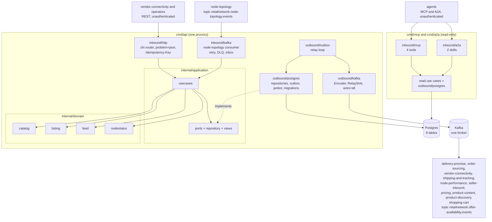

# Architecture

`offer-availability` follows the fleet's hexagonal (ports and adapters) layout: dependencies point inward, the domain
imports nothing from the rest of the module, and only `cmd/` wires the layers together. Everything on this page is on
`develop`; the rules are enforced by `internal/architecture` ([Testing](/docs/development/testing#fitness-tests-internalarchitecture)).

## Layout

| Layer | Path | Role |
| --- | --- | --- |
| Domain | `internal/domain/catalog` | `Item` aggregate (`CatalogItem`): specification, state `ACTIVE`/`DISCONTINUED`, optional GTIN, the packaging hierarchy (`packaging.go`: `EACH`, `INNER`, `CASE`, `PALLET`) and its events |
| Domain | `internal/domain/listing` | `Listing` aggregate: `LIVE`/`SUPPRESSED`, suppression reason, availability (quantity, basis, `asOf`, `feedId`), optional `OwnerRef`, events |
| Domain | `internal/domain/feed` | `InventoryFeed` aggregate: `RECEIVED` -> `APPLIED`/`FAILED`/`SUPERSEDED`, `Apply` over the listings of a node, `MaxLines = 10000`, events |
| Domain | `internal/domain/nodestatus` | `View`: the local copy of a node's status (`PROPOSED`, `ACTIVE`, `SUSPENDED`, `RETIRED`) with its `Observe` rules (older observations ignored, `RETIRED` final) |
| Domain | `internal/domain/shared` (+ `gs1`) | `Event`, `Header`, `ErrValidation`, `ErrIllegalTransition`; `gs1` parses and checks GTIN, SSCC and scans |
| Application | `internal/application/usecases` | The use cases ([Use cases](/docs/ddd/use-cases)): `CreateCatalogItem`, `DiscontinueItem`, `DeclarePackLevel`, `RetirePackLevel`, `CreateListing`, `ApplyInventoryFeed`, `ApplyNodeEvent`, the four queries; `writer` (unit of work + outbox publish) |
| Application | `internal/application/ports`, `repository`, `views`, `outbox` | The OUT ports (`CatalogRepository`, `ListingRepository`, `FeedRepository`, `NodeFeedMarks`, `NodeStatusRepository`, `ProcessedEvents`, `EventOutbox`, `EventEncoder`, `UnitOfWork`, `Clock`, `IDGenerator`, `FeedMetrics`), page filters, the read views returned to adapters, the already-encoded outbox `Message` |
| Inbound adapter | `internal/adapters/inbound/http` | chi router for `apis/openapi.yaml`: handlers, RFC 9457 problem mapping (`problems.go`), the `Idempotency-Key` middleware, NUL rejection, `/healthz`, `/readyz` |
| Inbound adapter | `internal/adapters/inbound/kafka` | The node-topology consumer: CloudEvents decode, dispatch on the full `type`, retry with backoff, dead-letter topic, consumer span |
| Inbound adapter | `internal/adapters/inbound/mcp` | Read-only MCP server (four tools) over the read use cases |
| Inbound adapter | `internal/adapters/inbound/a2a` | Read-only A2A agent (two skills, Agent Card) over the read use cases |
| Inbound adapter | `internal/adapters/inbound/requestlog` | The one-line `http request` access log shared by the three routers |
| Outbound adapter | `internal/adapters/outbound/postgres` | pgxpool repositories, `pgtx` unit of work, outbox repository (with trace-context headers), retention janitor, embedded migrations |
| Outbound adapter | `internal/adapters/outbound/outbox` | The relay loop that drains the outbox to a sink |
| Outbound adapter | `internal/adapters/outbound/kafka` | `Encoder` (domain events to CloudEvents messages), the writer (acks=all, hash balancer, `AllowAutoTopicCreation`), `RelaySink`, `BrokerCheck` (the Kafka half of `/readyz`) |
| Outbound adapter | `internal/adapters/outbound/telemetry` | OTel setup, the feed counter, slog trace correlation |
| Outbound adapter | `internal/adapters/outbound/{clock,ids}` | The production clock and the UUID id generator |
| Outbound adapter | `internal/adapters/outbound/memory`, `repocontract` | In-memory doubles for the unit and BDD tests and the shared repository contract suite; **never imported by `cmd/**`** (`TestRuntimeBinaryHasNoInMemoryAdapters`) |
| Kafka envelope | `internal/adapters/kafka/cloudevents` | The only place a CloudEvents 1.0 envelope is built or decoded. `Repo = "offer-availability"`, `Tier = "commerce"`, `Context = "offer-availability"`, `Source = "/retailnetwork/offer-availability"`, type `com.retailnetwork.commerce.offer-availability.<entity>.<Event>` |
| Support | `internal/bootretry` | Exponential-backoff retry for the first outbound dials at boot |
| Composition roots | `cmd/api`, `cmd/mcp`, `cmd/a2a` | Env parsing, adapter wiring, workers, shutdown order |
| Console | `web/` | Vite + React Module Federation remote `offer_availability_mfe`, served by its own nginx image ([ADR 0008](/docs/adr/0008-console-remote)) |

## Binaries and ports

| Binary | Role | Port | Probes |
| --- | --- | --- | --- |
| `cmd/api` | REST API, outbox relay, node-topology consumer and retention janitor in one process, all always on, on real Postgres and Kafka. The only writer and the only process that dials Kafka | `HTTP_ADDR`, default `:8080` | `GET /healthz` (liveness), `GET /readyz` (drain gate, Postgres ping, a Kafka broker answers a metadata request; never topics) |
| `cmd/mcp` | Read-only MCP server (Streamable HTTP) at `/mcp` and `/`, four tools ([ADR 0007](/docs/adr/0007-mcp-server-adoption)). No relay, consumer or Kafka | `MCP_ADDR`, default `:8090` | `GET /healthz` |
| `cmd/a2a` | Read-only A2A agent: JSON-RPC 2.0 on `/` and `/a2a`, Agent Card at `/.well-known/agent-card.json`, two skills ([ADR 0010](/docs/adr/0010-a2a-inbound-adapter)). No relay, consumer or Kafka | `A2A_ADDR`, default `:8093` | `GET /healthz` |

All three run the embedded migrations at boot. How `cmd/api` boots and stops is in [Runtime](/docs/overview/runtime) and the
[Runbook](/docs/operations/runbook); every variable is in [Configuration](/docs/operations/configuration).

## Container diagram

Source: `cmd/api/run.go` (`buildAdapters`, `buildServer`, the three workers), `cmd/api/workers.go`, `cmd/mcp/main.go`,
`cmd/a2a/main.go`, `internal/application/ports/ports.go`, `internal/adapters/outbound/kafka/encoder.go` and
`internal/architecture/architecture_test.go`. The in-memory adapters are not in the diagram because no binary wires them.

## Data stores

One Postgres database that this service alone owns (no shared tables). The three binaries share it; only `cmd/api`
writes. Two embedded migrations (`0001_offer_availability_schema`, `0002_catalog_packaging_and_listing_owner`) create:

| Table | Holds |
| --- | --- |
| `catalog_items` | The `CatalogItem` aggregate (state, optional `gtin` with a partial unique index, version) |
| `catalog_item_pack_levels` | Every pack level an item ever declared, retired ones included; one GTIN identifies one level forever; at most one active definition per (item, level) |
| `listings` | The `Listing` aggregate; unique on (`catalog_item_id`, `node_id`, `owner_ref`); `owner_ref ''` is operator-owned; no foreign key to `catalog_items` (aggregates reference each other by id) |
| `inventory_feeds` | One row per feed with counters, never the lines; retained 30 days |
| `node_feed_marks` | Per node, the `asOf` of the last applied feed; also the row lock that serialises the feeds of a node |
| `node_status_view` | Local copy of node-topology's node status (read model, [ADR 0003](/docs/adr/0003-consumed-contracts-and-local-node-status)) |
| `processed_events` | The consumer inbox, one row per CloudEvents id; retained 30 days |
| `outbox_events` | The transactional outbox, one row per encoded Kafka message. **Nothing purges it**: published rows stay (the retention janitor deletes only the three tables above) |
| `idempotency_keys` | Stored answers of keyed writes, 24 hours |

Kafka is the fleet's single broker. This service produces to `retailnetwork.offer-availability.events`, consumes
`retailnetwork.node-topology.events` and dead-letters to `retailnetwork.node-topology.events.dlq`. It never creates a
topic through an admin API: the writers set `AllowAutoTopicCreation`, and `/readyz` does not wait for any topic. There
is no analytics topic ([ADR 0004](/docs/adr/0004-cloudevents-envelope-and-type-catalogue)). Entity-level detail:
[Entity relationship](/docs/ddd/entity-relationship); layered types: [Class diagram](/docs/ddd/class-diagram).
